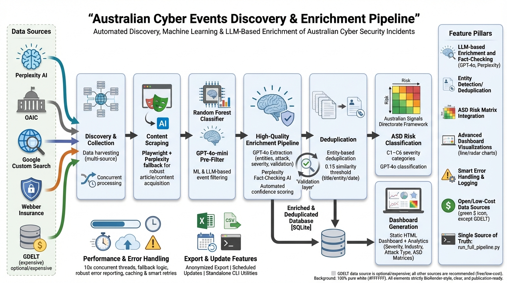

# Australian Cyber Events Discovery and Enrichment Pipeline

A Python pipeline for discovering, scraping, filtering, and enriching Australian cyber security events from multiple data sources using machine learning and LLM-based analysis.



---

## Quick Start — 3 Commands

All scripts must be run from the **project root directory**.

```bash
# Check status (last ingest + latest event in database)
python pipeline.py status

# Rolling 90-day refresh — recommended for monthly updates
python pipeline.py refresh

# Full pipeline with advanced options
python run_full_pipeline.py [options]
```

That's it for day-to-day use. Everything else is optional.

---

## Installation

```bash
git clone https://github.com/colinpriest/australian-cyber-events-scraper.git
cd australian-cyber-events-scraper

pip install -r requirements.lock      # exact versions the tests pass with
# (requirements.txt holds the ranges; regenerate the lock with
#  python scripts/setup/lock_dependencies.py after changing it)

# For OAIC Power BI dashboard scraping (optional):
playwright install chromium

# Configure API keys
cp .env.example .env
# Edit .env with your keys

# Create the database (or upgrade an existing one) - idempotent
python pipeline.py init
```

`init` applies the numbered SQL migrations in
`cyber_data_collector/storage/migrations/` (recorded in `SchemaMigrations`
with a checksum) and then every module's own schema step. CI
(`.github/workflows/ci.yml`) installs from the lock, initialises an empty
database and runs the tests, including a clean-install smoke test that takes
mocked source responses through storage, deduplication and status.

---

## Environment Variables

Create a `.env` file:

```env
# Required
OPENAI_API_KEY=your_openai_api_key

# Recommended (for event discovery)
PERPLEXITY_API_KEY=your_perplexity_api_key

# Required for the data-quality steps (Jev judgements with probabilities). Without it those
# steps fail and the run ends degraded - no other model is substituted.
TYPESAFE_API_KEY=your_typesafe_api_key

# Optional model overrides - defaults are pinned, dated snapshots (see "Language models")
# OPENAI_MODEL=gpt-5.5-2026-04-23
# OPENAI_FAST_MODEL=gpt-5.4-mini-2026-03-17
# TYPESAFE_MODEL=jev-1.14.0

# Optional (for Google Search source)
GOOGLE_CUSTOMSEARCH_API_KEY=your_google_api_key
GOOGLE_CUSTOMSEARCH_CX_KEY=your_cx_key

# Optional (GDELT only — WARNING: expensive BigQuery fees)
# GOOGLE_CLOUD_PROJECT=your_project_id
# GOOGLE_APPLICATION_CREDENTIALS=path/to/service-account.json

# Database
DATABASE_URL=sqlite:///instance/cyber_events.db

# Processing
MAX_THREADS=10
BATCH_SIZE=20
```

---

## Language models and replicability

Every LLM call takes its model from
[`cyber_data_collector/utils/llm_models.py`](cyber_data_collector/utils/llm_models.py),
so three settings describe a run completely:

| Setting | Default (dated snapshot) | Used for |
|---|---|---|
| `OPENAI_MODEL` / `--openai-model` | `gpt-5.5-2026-04-23` | adjudication, partitions, coherence, dates, ASD classification, OAIC vision extraction |
| `OPENAI_FAST_MODEL` / `--openai-fast-model` | `gpt-5.4-mini-2026-03-17` | discovery filtering, entity extraction, summaries, page classification without Jev |
| `TYPESAFE_MODEL` / `--jev-model` | `jev-1.14.0` | bounded judgements that return probabilities (page classification today) |

The options are accepted by `run_full_pipeline.py`, `scripts/dedup_admin.py`,
`scripts/run_global_deduplication.py`, `scripts/asd_risk_classifier.py` and
the export scripts. Defaults are dated snapshots, never aliases (`gpt-5.5`,
`jev-latest`), because an alias can change under the code. GPT-5 calls are made
with `reasoning_effort="none"` and `temperature=0`, the most repeatable
sampling those models allow. GPT-4o / GPT-4o-mini were used until 2026-10;
GPT-4o-mini is withdrawn in January 2027.

**Jev answers are stored, not re-asked.** Jev returns probabilities (a Choice's
distribution, a Noul's probability, a Score's level distribution) and is not
fully deterministic - the same question can return 0.99 and then 0.98. Every
answer is written to `ModelJudgements` with the question exactly as sent, a
hash of the input, the version that answered and the full distribution, and a
re-run reuses the stored answer unless the question, the input or the model
changes. The database is therefore the record of each decision: a replication
with the published database reproduces the decisions; one from scratch
reproduces them up to Jev's sampling variation, which the stored
distributions let you measure. See
[`cyber_data_collector/utils/jev.py`](cyber_data_collector/utils/jev.py).

```sql
-- Every page verdict with its distribution
SELECT subject_id, answer, value, probabilities_json, model, created_at
FROM ModelJudgements WHERE question_id = 'page_kind';
```

---

## pipeline.py — Simplified CLI

```bash
python pipeline.py refresh          # Rolling 90-day refresh (recommended)
python pipeline.py status           # Show last ingest and latest event
python pipeline.py rebuild --force  # Wipe and fully rebuild (destructive)
python pipeline.py init             # Create or upgrade the database schema
```

Every command acts on one database, resolved once: `--db-path`, else
`DATABASE_URL`, else `instance/cyber_events.db`. `rebuild` takes a verified
backup of that database before wiping it, and the wipe, the backup and the
rebuild all use the same file (it used to wipe the default database whatever
`--db-path` said).

---

## run_full_pipeline.py — Advanced Control

The unified 5-phase pipeline: Discovery → Perplexity Enrichment → Deduplication → ASD Classification → Dashboard.

```bash
# Full pipeline (all phases)
python run_full_pipeline.py

# Discovery only (auto-enriches with Perplexity)
python run_full_pipeline.py --discover-only

# Re-enrich existing events
python run_full_pipeline.py --re-enrich [--re-enrich-limit N]

# ASD Risk Classification only
python run_full_pipeline.py --classify-only [--classify-limit N]

# Dashboard only (data already collected)
python run_full_pipeline.py --dashboard-only

# Specific sources, limits, date window
python run_full_pipeline.py --source Perplexity OAIC GoogleSearch WebberInsurance --days 30 --max-events 500

# Skip classification (faster)
python run_full_pipeline.py --skip-classification
```

### Options

| Option | Description | Default |
|--------|-------------|---------|
| `--discover-only` | Discovery phase only | False |
| `--dashboard-only` | Dashboard generation only | False |
| `--classify-only` | ASD classification only | False |
| `--re-enrich` | Re-enrich existing events | False |
| `--re-enrich-limit N` | Limit re-enrichment count | No limit |
| `--skip-classification` | Skip ASD classification | False |
| `--classify-limit N` | Limit classification count | No limit |
| `--force-dedup` | Force full deduplication rebuild (skip incremental mode) | False |
| `--skip-recurrence-check` | Skip re-checking short-gap repeat attacks | False |
| `--recurrence-window N` | Gap in days below which a repeat is re-checked | 90 |
| `--recurrence-min-certainty F` | Certainty required to merge a suspected re-report | 0.85 |
| `--skip-missed-merge-check` | Skip the multi-key search for duplicates incremental dedup missed | False |
| `--missed-merge-apply` | Merge missed-duplicate findings automatically (default: report only) | False |
| `--missed-merge-days N` | Only judge pairs touching events changed in the last N days | 120 |
| `--missed-merge-min-certainty F` | Certainty required to merge a missed duplicate | 0.9 |
| `--skip-entity-sizing` | Skip estimating size bands for new entities | False |
| `--entity-size-limit N` | Cap entities sized per run | No limit |
| `--evidence-recovery-limit N` | Incidents with no usable evidence given new retrieval work per run (see [Incidents with no usable evidence](docs/11-evidence-recovery.md)) | 100 |
| `--continue-on-error` | Continue if a phase fails | False |
| `--enrich-limit N` | Most records automatic Perplexity enrichment takes per run (0 = no limit); the rest waits for the next run | 500 |
| `--api-budget P=N ...` | Requests allowed this run per paid API (`openai`, `perplexity`, `typesafe`); also `API_BUDGET_<PROVIDER>` | Unlimited |
| `--source SOURCE [SOURCE ...]` | Data sources to use | All |
| `--max-events N` | Max events per source per month | 1000 |
| `--days N` | Lookback window in days (0 = full history) | 0 |
| `--out-dir DIR` | Dashboard output directory | dashboard |
| `--db-path PATH` | Database file path | instance/cyber_events.db |

---

## Pipeline Phases

```
[Data Sources] → [Discovery & Scraping] → [Perplexity Enrichment]
                                                     |
                         [ML Filtering]     [Global Deduplication]
                                 |                   |
                                 └────────┬───────────┘
                                          ↓
                               [ASD Risk Classification]
                                          ↓
                               [Dashboard Generation]
```

1. **Discovery** — Collects events from Perplexity, OAIC, Google Search, Webber Insurance, Cyber Daily, GDELT. Scrapes full content. Judges each page with the calibrated Jev page gate, then the fast-model classification (see [Discovery filter and retry queue](#discovery-filter-and-retry-queue)).
2. **Perplexity Enrichment** — Extracts formal entity names, threat actors, attack methods via multi-source verification.
3. **Global Deduplication** — Merges only what is certain: an identical title on the same date, or the same organisation (by identity) on the same exact day. Everything else is decided by the calibrated Jev duplicate check that follows. See [Global Deduplication](#global-deduplication).
4. **ASD Risk Classification** — Assigns C1–C6 severity categories using the Australian Signals Directorate risk matrix. Incremental (skips already-classified events).
5. **Dashboard Generation** — Static HTML dashboard with Chart.js visualizations and ASD risk matrices for all years.

---

## Data Sources

| Source | Cost | API Key |
|--------|------|---------|
| Perplexity AI | ~$0.005/query | `PERPLEXITY_API_KEY` |
| OAIC | Free | None |
| Google Custom Search | Free (100 queries/day) | `GOOGLE_CUSTOMSEARCH_API_KEY` + `CX_KEY` |
| Webber Insurance | Free (scraping) | None |
| Cyber Daily | Free (section RSS feed) | None |
| GDELT | **WARNING: $500–$2000+** | Google Cloud + BigQuery |

> Do not enable GDELT unless you have a BigQuery budget. Use `--source Perplexity OAIC GoogleSearch WebberInsurance CyberDaily` to exclude it.

**Cyber Daily** (`CyberDaily`, added 2026-10-28) reads the Security section's
public RSS feed. The feed gives title, standfirst, publication date and URL,
and goes back to 2018. The article page is scraped and judged like any other
source's page. Its value is ransomware leak-site claims against small
Australian organisations that no other source reports. Of 1,001 Security
articles in the 12 months to 2026-10-27, 68 were already in the database. A
seeded sample of the rest suggests about 85 further Australian incidents a
year; the database holds 146 active events for that period.

The site's free-reading meter does not get in the way. 351 of 360 stored pages
hold the full article (most after a "N free articles left" banner), and the
other 9 keep the lead. Page-gate and event-reality scores do not differ. The
text the site hides behind its paywall is not read. Nothing logs in either:
the login form requires a Cloudflare Turnstile check, which the pipeline does
not try to get past.

With CyberDaily among the sources, every run also does two more things:

- **Backfill.** It searches processed months back to 2020-01 that Cyber Daily
  has not searched yet. The first run therefore covers about 5,000 articles
  and takes hours; it is resumable per month, and later runs have nothing left
  to do.
- **Re-fetch.** It fetches stored Cyber Daily stories again: the last 90 days,
  plus any cut off or too short. Changed text is stored and re-enriched;
  unchanged text writes nothing.

```bash
python scripts/discovery_queue.py backfill --source CyberDaily --since 2020-01 [--force]
python scripts/discovery_queue.py refetch-cyberdaily [--days 90 | --all] [--dry-run]
python run_full_pipeline.py --cyberdaily-backfill-since none --skip-cyberdaily-refetch   # opt out for a run
```

Details: [docs/01-data-sources.md section 5a](docs/01-data-sources.md#5a-cyber-daily).

---

## Project Structure

```
australian-cyber-events-scraper/
├── pipeline.py                    # Simplified CLI entry point (refresh/status/rebuild)
├── run_full_pipeline.py           # Advanced 5-phase pipeline entry point
├── requirements.txt
│
├── cyber_data_collector/          # Core package
│   ├── datasources/               # Perplexity, OAIC, Google Search, Webber, Cyber Daily, GDELT
│   ├── enrichment/                # High-quality 5-stage enrichment pipeline
│   ├── filtering/
│   │   ├── page_gate.py           # Jev discovery page gate (rf_event_filter.py: retired)
│   │   ├── progressive_filter.py
│   │   └── confidence_filter.py
│   ├── models/                    # CyberEvent, EventSeverity, CyberEventType
│   ├── pipelines/
│   │   └── discovery.py           # Discovery and initial processing pipeline
│   ├── processing/                # LLM classification, deduplication, enrichment
│   ├── storage/
│   │   ├── cyber_event_data_v2.py # Thread-safe SQLite database operations
│   │   ├── database.py
│   │   └── deduplication_storage.py
│   ├── utils/
│   │   ├── entity_scraper.py      # Playwright-based web scraping
│   │   ├── llm_extractor.py       # GPT-4o-mini event extraction
│   │   └── ...
│   └── tests/
│
├── scripts/                       # Utility scripts (run from project root)
│   ├── asd_risk_classifier.py     # Standalone ASD risk classification
│   ├── build_static_dashboard.py  # HTML dashboard generation
│   ├── analyze_recurrent_timing.py # Repeat-event survival/recurrent timing analysis
│   ├── build_recurrence_dashboard.py # All recurrence runs on one HTML page
│   ├── recurrence_conclusions.py  # Conclusion sentences generated from the estimates
│   ├── quality_report.py          # Quality metrics, history and the publication gate
│   ├── perplexity_backfill_events.py  # Backfill Perplexity enrichment
│   ├── project_status.py          # Pipeline status reporter
│   ├── run_global_deduplication.py    # Standalone deduplication runner
│   ├── wipe_database.py           # Database reset utility
│   ├── oaic/
│   │   ├── oaic_data_scraper.py       # OAIC PDF report scraper (<= 2024 H2)
│   │   ├── OAIC_dashboard_scraper.py  # OAIC Power BI dashboard scraper (<= 2025 H1)
│   │   ├── oaic_datagov_scraper.py    # OAIC data.gov.au XLSX ingester (2025 H2 onward)
│   │   ├── refresh_oaic_statistics.py # Routine refresh into the published dataset
│   │   ├── oaic_dataset.py            # Published dataset: promote-on-pass, refresh state
│   │   ├── oaic_consistency.py        # Shared internal-consistency rules
│   │   └── cleanup_oaic_data.py       # OAIC data validation (fails on corrupt files)
│   ├── export/
│   │   ├── export_events_excel.py     # Export to Excel with LLM summaries
│   │   └── export_cyber_events.py     # Full database export (CSV/Excel)
│   └── setup/
│       └── setup_bigquery_auth.py     # BigQuery authentication setup
│
├── docs/                          # Detailed pipeline stage documentation
├── analysis/                      # Generated statistical analysis reports
├── machine_learning_filter/       # Retired Random Forest model artifacts (kept for reproduction)
├── instance/                      # SQLite database (gitignored)
├── logs/                          # Log files (unified_pipeline.log, etc.)
├── dashboard/                     # Generated HTML dashboard (gitignored)
└── risk_matrix/                   # Generated ASD risk matrix Excel files
```

---

## Utility Scripts

All utility scripts are in `scripts/` and must be run from the project root.

### ASD Risk Classifier

```bash
python scripts/asd_risk_classifier.py                     # Classify all unclassified events
python scripts/asd_risk_classifier.py --limit 50          # Limit to 50 events
python scripts/asd_risk_classifier.py --force-reclassify  # Re-classify all events
python scripts/asd_risk_classifier.py --output-dir my_matrices
```

When the evidence cannot decide a severity, impact or stakeholder the answer
is `Insufficient information` (prompt `asd-v2`), never a default C6; such
classifications are listed under the matrix (dashboard) and on a "Not placed"
sheet (Excel), not put in a cell. `ASDRiskClassifier.process_events` sets
`failed_count` / `failed_event_ids` for events it could not classify (their
old classifications stay stale and counted by `stale_count()`); the script
exits 1 if any failed. Each risk-matrix workbook is written to a temporary
file and moved into place, so a failure raises `RiskMatrixExportError` and
leaves the previous workbook untouched; an empty matrix is written only for a
population with no classifications.

### Global Deduplication

```bash
python scripts/run_global_deduplication.py             # Incremental deduplication (new events only)
python scripts/run_global_deduplication.py --force      # Full rebuild (reprocess all events)
python scripts/run_global_deduplication.py --dry-run   # Preview without changes
python scripts/run_global_deduplication.py --verbose    # Enable verbose logging
```

**What merges here.** Only two deterministic rules, shared by the full
rebuild and the incremental matcher (`DeduplicationEngine.merge_decision`):

- an identical title on the same date;
- the same victim organisation on the same exact day. "Same" means identity -
  legal-suffix and spelling variants, known aliases, compound names sharing a
  whole member - never a shared word: the old fallback treated any two titles
  containing "university", "council", "hospital" or "health" as one
  organisation. An event with no recorded victim matches nothing. The 1st of a
  month does not count as an exact day, because it is how a month-only date is
  stored.

The fuzzy rules (titles 15% alike, descriptions 20-35% alike) are gone; those
pairs stay separate and the calibrated `check-duplicates` step decides them
with both events' evidence, date provenance and the organisation's timeline.
Incremental matching also respects cached `different` rulings, and attaches
every record of a matched group (only the lead record used to be attached,
which left 34 live records in no event).

**Membership check.** A run fails if any active record belongs to no event or
to more than one; records removed by a merge or rejection are not counted.

**Records that change after placement.** `RecordFingerprints` remembers what
each placed record looked like. When a record is re-enriched (a corrected date,
victim research or record count), its events are refreshed with their ids
kept: title and date re-derived from all members, fields copied from the master
record updated unless corrected at event level since, and entity roles marked
outdated for the hygiene phase's `classify-entities --stale-only`. ASD
classifications store a fingerprint of their inputs (event fields, prompt
version, model) and are redone when it changes; Jev judgements already key on
an input hash. So re-enrichment improves the published results without a full
rebuild.

> **Note on the incremental-mode warning.** `run_full_pipeline.py` warns when
> dedup output is under 10% of input. In incremental mode `output_events`
> counts only *newly created* dedup rows — events that merge into existing rows
> are counted separately — so a low ratio is normal and not evidence of
> over-merging. Check `merged into existing` in the log before acting on it.

### Deduplication v3 — audit, review and correction

Entity-aware, LLM-adjudicated deduplication with a full audit trail, reversible
merges, and human overrides that survive rebuilds. Full design:
[docs/09-deduplication-v3.md](docs/09-deduplication-v3.md).

```bash
python scripts/dedup_admin.py migrate                       # idempotent schema
python scripts/dedup_admin.py backfill --dry-run            # repair lineage + provenance
python scripts/dedup_admin.py backfill

python scripts/dedup_admin.py find-missed --no-llm          # free candidate preview
python scripts/dedup_admin.py find-missed                   # adjudicate (embeddings + GPT-4o)
python scripts/dedup_admin.py apply-missed --min-certainty 0.9

python scripts/dedup_admin.py override <enr_a> <enr_b> different --reason "..."
python scripts/dedup_admin.py split <dedup_id> <enriched_id> --reason "..."
python scripts/dedup_admin.py learn                         # fold corrections back in
python scripts/dedup_admin.py ancestry <dedup_id>           # provenance tree as JSON
```

Every merge records who decided, how certain, by what method, the reasoning and
the evidence. Splits and merges run against stored state — **no re-scraping or
pipeline rerun** — and each mutation snapshots the previous state for restore.
Overrides are keyed on `enriched_event_id` pairs (stable) rather than
`deduplicated_event_id` (regenerated every rebuild), so corrections persist.

### Missed-duplicate detection: three candidate keys

Deduplication can only merge what candidate generation puts in front of it. A
review of May/June 2026 found 21 duplicates still stored as separate events,
and the original blocking - on the single `victim_organization_name` - would
have surfaced only **9 of them**. Three shapes defeated it:

| Shape | Example | Key that catches it |
|---|---|---|
| No usable victim name | "Australian sugar producer", "Queensland education sector" | every organisation linked to the event: entity links, vendor, and Perplexity's formal victim name on each source record |
| Same article, different framing | "OpenAI slows training" vs "OpenAI hacked Medicare portal" | a shared source URL, ignoring *hub* URLs (roundups, breach lists, section indexes cited by more than 3 events) |
| Supplier breach, a different victim per report | Canvas/Instructure -> USyd, QLD DoE, DECYP | a corpus-rare subject word shared within 60 days |

With all three, 20 of the 21 surface. Precision still comes from the
adjudicator: a shared article or subject sends the pair to GPT-4o (past the
name gate and embedding filter, which would wrongly reject it) rather than
merging on a rule, because one article can cover two incidents. The prompt
states the project convention that one supplier breach reported about several
customers is one event.

`run_full_pipeline.py` runs this after every incremental dedup, scoped to pairs
touching events changed in the last 120 days, and writes findings to
`instance/dedup_missed_merges.json` **for review - it does not merge** unless
`--missed-merge-apply` is passed (`--skip-missed-merge-check` to skip it).

Why report-only: on a labelled set from the May/June 2026 review, pairwise
adjudication at certainty >= 0.9 kept 28 of 30 true duplicates but still
accepted 11 of 22 known-wrong pairs, mostly roundup / newsletter / guidance
pages matched to the incidents they mention, and it confidently rejected
misdated fragments of one incident when shown them two at a time. Better
candidate generation fixed recall; precision needs (1) junk pages rejected
before deduplication and (2) whole-cluster adjudication over the candidate
graph, as `adjudicate-clusters` does, instead of pairwise judgement.

**Stage 2 (2026-10-02) - measured, still report-only.** Whole-group
adjudication (`adjudicate-candidates`, now the routine step) partitions groups
of strongly-linked candidates instead of judging pairs. On the labelled set:

| At certainty >= 0.9 | Wrong pairs accepted | Genuine kept | Known May/June fragments |
|---|---|---|---|
| Pairwise (`find-missed`) | 2/10 | 34/36 | 9/21 |
| Whole-group, uncapped | 1/10 | 20/38 | 14/21 |
| Whole-group, groups capped at 20 (current) | 3/10 | 31/38 | 11/21 |

None is safe to merge unattended - each accepts some genuinely separate
incidents (Mathspace/Tixel, MIFF/Hampr, two Sarcoma victims) - so the routine
step proposes and a human confirms with `dedup_admin.py merge`. Uncapped
groups chained 545 of 820 events together through shared articles and rare
words, hence the size cap.

Also in stage 2: suspect pages are classified (`classify-pages`, gpt-4o-mini,
verdicts stored in `PageClassifications`) and confident roundup / guidance /
profile / index verdicts count as non-incidents; merges and splits date an
event by member consensus instead of earliest-wins, and a 1st-of-month
placeholder gives way to a day the members agree on. Known open issue:
*contaminated* events that contain a stray record about another incident
(RACGP holding a Smoke Alarm Solutions record) pull the adjudicator toward
wrong matches; `recheck-splits` / `split` are the current remedy.

A full sweep is manual:

```bash
python scripts/dedup_admin.py adjudicate-candidates --dry-run --verbose   # whole groups (routine step)
python scripts/dedup_admin.py classify-pages && python scripts/dedup_admin.py reject-non-incidents
python scripts/dedup_admin.py find-missed                  # all pairs
python scripts/dedup_admin.py find-missed --recent-days 120
python scripts/dedup_admin.py apply-missed --min-certainty 0.9
python scripts/dedup_admin.py merge <target_dedup_id> <source_dedup_id> --reason "..."
```

### Cached rulings: splits stay split

Every split is recorded as a `different` ruling in `DedupOverrides` between
the departing record(s) and every record left behind, and `merge_events`
refuses to join two events when any record of one has a `different` ruling
against any record of the other. So a manual correction cannot be undone by a
later automated pass (`find-missed`, `adjudicate-candidates`,
`reconcile-entities`, `adjudicate-clusters`, `check-recurrences`, ...).
Rulings are keyed on `enriched_event_id`, which survives rebuilds.

```bash
# Move records out together as ONE event (rulings only against what stays)
python scripts/dedup_admin.py split <dedup_id> <enriched_id> [<enriched_id> ...] --reason "..."
# A human can still overrule a cached ruling deliberately
python scripts/dedup_admin.py merge <target> <source> --reason "..." --force
```

Move a multi-record incident out with one `split` naming all its records:
splitting them one at a time caches rulings *between* them, and the safeguard
then (correctly) refuses to regroup them.

### Calibrated data-quality filters

Every refresh cleans the data after deduplication and before the recurrence
check (`run_full_pipeline.py`, `--skip-data-hygiene` to opt out). Each step
that deletes, merges or re-attributes acts only at a cut-off **calibrated on
labelled examples from this database**, recorded with the models and question
versions it was measured on; change a model or a question and the step falls
back to reporting until it is recalibrated. Labels are ground truth: an item
labelled one way is never acted on the other way. A labelled non-incident is
rejected whatever it scores, unless it holds a record it did not hold when
labelled (checked against the labelling snapshot; then it is held for review).
A labelled junk page that is the only record of a labelled-real event is
removed and the event kept for its replacement evidence.

| Order | Step | What it decides | Model | Cut-off (2026-10-27) | Precision on labels | Recall | Out-of-sample* |
|---|---|---|---|---|---|---|---|
| 0 | `check-sources --apply` | Does a Google result's page itself report an incident? | Jev | remove below **0.58** | 0.953 (95/100) | 0.97 | 0.95 |
| 1 | `classify-pages` | What kind of page each suspect record is (informs, removes nothing) | Jev | - | - | - | - |
| 2 | `check-events --apply` | Is the event a real, specific incident? | Jev + escalation | reject below **0.28** | 0.954 (68/72) | 0.71 | 0.91 |
| 3 | `check-victims` | Do the records name a different victim? (deterministic rule) | none | - | 8/9 reviewed | - | - |
| 3b | `check-coherence --apply` (not yet wired into `run_full_pipeline.py`) | Is each suspect record about its event's incident? (splits strays out) | Jev + escalation | split below **0.15** | 1.00 (17/17) | 0.94 | 0.98 |
| 4 | `check-duplicates --apply` | Are two events about one organisation the same incident? | Jev + escalation | merge at **0.81** | 1.00 (16/16) | 0.94 | 0.97 |
| 3b | `check-victim-attribution --apply` | Is the recorded victim really the affected organisation? Demote / replace from the evidence / flag | Jev + escalation | act below **0.15**; replace at choice **0.84** | 0.956 (43/45); replacements 23/25 | 0.38 | 0.94 |
| 5 | `reconcile-timelines --queue-gaps` | Do events agree with the organisation's researched timeline? Resolved by steps 2 and 3b; re-dating report only (2 eligible conflicts, too few to calibrate) | Jev | - | - | - | - |

\*Mean precision of the whole choose-then-test procedure on held-out labels
(stratified bootstrap), the honest estimate - choosing a cut-off on the labels
it is scored on flatters it.

```bash
python scripts/dedup_admin.py check-sources [--apply] [--unmapped-only]
python scripts/dedup_admin.py check-events [--apply]
python scripts/dedup_admin.py check-victims [--dry-run]
python scripts/dedup_admin.py check-coherence [--apply] [--event <dedup_id>]
python scripts/dedup_admin.py check-duplicates [--apply]
python scripts/dedup_admin.py check-victim-attribution [--apply]
python scripts/dedup_admin.py research-timelines
python scripts/dedup_admin.py reconcile-timelines [--queue-gaps] [--apply]
```

These commands fail (exit 2) rather than skip when Jev or Perplexity is
needed and unavailable, and `--apply` refuses when its labels file is
missing, unreadable or empty. A calibration measured on another model or
question version makes the step report-only, and the log says so.

**Flagged victims are reassessed, and unresolved ones are marked.** When
`check-victim-attribution` finds a recorded victim below the cut-off and
neither a co-victim nor a calibrated replacement can take its place, it
*flags* the pair and leaves it. Each action row records the hash of the input
it judged and the event's member signature, and every run judges every pair
again (Jev is asked only where the evidence, the timeline or the membership
changed). So a flagged pair ends each run **confirmed** (re-judged at or above
the cut-off, or labelled correct: a `confirmed` row clears the flag),
**replaced** (demoted or re-attributed), or **still flagged** with its reason.
A still-flagged pair is an *unresolved attribution*. The incident stays in
every count, and victim counting, the by-entity dashboard ("attribution
unresolved" badge and filter) and the recurrence analysis (counts and repeats
with them included and excluded, `--unresolved-attributions exclude`) mark it
separately. On the 2026-10-28 copy, 43 active pairs were flagged; 15 had
changed input and are re-judged on the next run. Details:
[docs/10-victim-attribution-and-timelines.md](docs/10-victim-attribution-and-timelines.md).

**Labels** (all blind to the model being calibrated, each with a written
reason; reviewed where flagged): `evaluation/source_gate_labels.csv` (170
pages), `evaluation/event_reality_labels.csv` (168 events),
`evaluation/duplicate_labels.csv` (157 pairs - every same-victim pair),
`evaluation/coherence_labels.csv` (148 event members - every suspect).
`evaluation/victim_attribution_labels.csv` (151 event-victim pairs; see
[docs/10-victim-attribution-and-timelines.md](docs/10-victim-attribution-and-timelines.md)).
Labellers were Claude Opus 5.5 subagents working from the stored evidence plus
web searches; conventions worth reviewing are noted in each file's rationales
(dark-web sale claims naming no victim = unsure; campaigns naming no victim,
physical-security incidents and non-cyber fraud = not an incident).
An event label `out_of_scope` marks a real incident outside the dataset (not
Australian): `check-events --apply` rejects it, the quality gate checks it
stays rejected, and calibration leaves it out.

**Labelled-real events with no evidence.** The source gate keeps a
labelled-real event whose only page was junk, but the page stays mapped to it
and contradicts the page labels. `dedup_admin.py label-evidence` (the first
hygiene step) queues the report the label cites (`corroboration` column) for the
next refresh - processing a stored copy again rather than storing it twice -
and once that report is a record, merges its event into the labelled one and
splits the inactive pages out and rejects them. A cited report that is
processed and still rejected is reported, not left waiting.

**Incidents with no usable evidence.** On 2026-10-28, 169 of 1,202 active
incidents had neither 300 characters of stored page text nor validated
Perplexity research (on the evening copy, 121 of 152 were Cyber Daily stories
ingested that day with no page text at all). `dedup_admin.py recover-evidence`
(`processing/evidence_recovery.py`, the second hygiene step) finds what each
incident's records lack and queues retrieval through the existing queues only,
at most `--evidence-recovery-limit` (100) incidents a run: the record's own page
re-fetched (the Cyber Daily re-fetch, or `rescrape-short-pages` for any other
source, which then queues the record's unvalidated research again), Perplexity
enrichment (unsupported incidents first), the report a label cites, and - only
when all of those are out of reach - one stored replacement search whose best
citation becomes a **new record with its own URL**, joined to the incident only
by the calibrated duplicate check. Another page's text is never passed off as
the record's own. Every incident gets `DeduplicatedEvents.evidence_status`:
`supported` (own page text and validated research), `partial` (one of them, or
only another page's text) or `unsupported` (neither; `evidence_uncertain_fields`
lists the fields nothing supports), with the reason. Exports, the main and
entity dashboards and the quality report (with a trend table) show it.
Details: [docs/11-evidence-recovery.md](docs/11-evidence-recovery.md).

```bash
python scripts/dedup_admin.py recover-evidence --dry-run     # what would be queued
python scripts/dedup_admin.py recover-evidence               # queue + mark status
python scripts/dedup_admin.py recover-evidence --status-only # re-mark only
```

**Calibrating** (`scripts/calibrate_source_gate.py`,
`calibrate_event_reality.py`, `calibrate_duplicates.py`): samples are
stratified on the model's own stored score (a census of the low band, where
any cut-off lies, plus seeded samples above it, weighted back), labelled, and
the cut-off is the largest (or, for merges, smallest) at which at least 95% of
the labelled items it would act on are correct. Labels describe the database
as it was when labelled - after rejections and merges the labelled items no
longer exist as active events or pairs - so recalibration runs on the backup
taken at labelling time (`scripts/prepare_calibration_snapshot.py`, which
carries stored research over); the snapshot used is recorded.

**What each step fixed**:

- *Source gate.* Google matches results on a snippet, which picks up incident
  words from menus, footers and policies; enrichment then attached the
  organisation's real incident to the page. Service NSW's "Report identity
  theft" help page became a second Service NSW attack weeks after its real
  March 2020 breach; LUSH's privacy policy became LUSH's breach. Applied: 469
  of 1,074 Google records removed (65 events left with no evidence, 404 junk
  records split out of events that keep other evidence). Pages with under 300
  characters of stored text are not judged; `rescrape-short-pages` re-fetches
  them (Playwright, no Perplexity substitutes; real text only, given up after 3
  failed attempts, tracked in `PageRescrapes`) so the next `check-sources`
  can. Where a removed record pointed at
  a real incident no other event covers, a targeted search queues proper
  reporting for normal ingestion (80 queued; 54 became events' evidence on the
  next pass).
- *Event reality.* Jev sees every record's page text, Perplexity research, a
  corroboration search (for events its screen scores below 0.5) and the
  victim's researched incident timeline; scores in 0.1-0.7 are re-judged by
  GPT-5.5 with reasoning. A page saying what an event is not is no evidence the
  event did not happen - for real incidents the stored page is often a privacy
  policy - so judging events, not pages, is what made rejection safe: on stored
  evidence alone no cut-off reached 95% precision (0.78 at best).
- *Victims.* When no record names the event's victim and two thirds name one
  other organisation, that organisation becomes the victim (guarded against
  legal and parent names, suppliers, products and regulators). Fixed TPG's
  breach filed under Optus, Henning Harders under Toll, Sharp Office Systems
  under Sharp Motor Group. Canonicalisation no longer folds names sharing a
  brand word across lines of business.
- *Duplicates.* Every pair of events sharing a victim, with both events'
  evidence, the gap in days, **how each date was determined** (stated,
  researched, publication or discovery date; day, month or year precision -
  `dedup/date_provenance.py`) and the organisation's timeline; 0.2-0.8
  escalated. Merged ACT Government's help pages into its June 2023 Barracuda
  breach and Services Australia's notice into Spectrum Medical Imaging's
  breach; the older GPT recurrence check had proposed those at 0.55 and 0.78,
  under its unmeasured 0.85 bar.

### Investigation tier: organisation timelines and escalation

Judging an event or a pair in isolation cannot answer what decides it: how
many incidents did this organisation actually have, and when? The labellers
answered that by searching - Western Sydney University had four separate
incidents (2023, August 2024, January 2025, June 2025).

- **Timelines** (`dedup/org_timeline.py`): one Perplexity search per
  organisation with several events, for its full incident history - dated,
  with what happened, how it became public and a source. Stored in
  `OrganisationTimelines` (a live search cannot be replayed) and shown to Jev
  for reality, duplicate and victim judgements. **Kept current**: a timeline is
  re-researched whenever a record about the organisation arrives after it was
  researched (a timeline that predates an incident does not list it, and the
  judgements treat "matches nothing in the researched history" as evidence
  against an event). Every version is kept; the latest is used; a new version
  changes the judgements' input, so affected events and pairs are re-judged
  automatically.
- **Escalation** (`utils/escalation.py`): cases Jev scores in a fixed middle
  band go to the strong OpenAI model with reasoning on, over the same evidence;
  its probability replaces Jev's and is stored with its rationale.
- **Reconciliation** (`dedup/timeline_reconciliation.py`,
  `reconcile-timelines`): matches each event to its organisation's timeline
  and resolves what disagrees - wrong-organisation events through the
  calibrated victim attribution, not-an-incident events through the calibrated
  event-reality filter, date conflicts by calibrated re-dating (`--apply`),
  incidents with no event by `--queue-gaps`; timeline gaps stay a report. Its
  verdicts appear on the timeline dashboard.
- **Timeline question v2**: aliases must be spellings of the same name (a
  misfiled record once put "Aussie Fluid Power" into the AFP's question, and
  the timeline then vouched for the misattribution); multinationals and
  declined questions are asked about Australia only; supplier breaches get
  their own instruction. A failed refresh is recorded and raises, and
  judgements are told when a timeline may be incomplete. Details:
  [docs/10-victim-attribution-and-timelines.md](docs/10-victim-attribution-and-timelines.md).

Every Jev and escalation answer is stored in `ModelJudgements` with the
question as sent, a hash of the input, the version that answered and the full
distribution, and reused unless the question, the input or the model changes.

### Supplier incidents: every affected organisation, one incident

A supplier breach (ProctorU 2020 and ten universities; Frontier Software's
payroll; Canvas/Instructure; HWL Ebsworth's clients) is one incident with
several co-equal victims. `find-supplier-victims` detects supplier incidents
(a vendor, or text describing a third-party compromise), gathers candidate
victims from the records' links, Perplexity's research and - with
`--research` - one stored search per incident, and finds other events that are
the same incident under another customer. Jev judges each (middle band
escalated; a failed escalation leaves the item undecided). With `--apply` and a
calibration for the current models and questions it merges those events
through the ledger and attaches the accepted customers as `victim` roles, with
an audit row each; a victim that still has its own separate event near the
incident is held rather than counted twice.

```bash
python scripts/dedup_admin.py find-supplier-victims --research            # report
python scripts/dedup_admin.py find-supplier-victims --research --apply    # act (calibrated)
python scripts/calibrate_supplier_victims.py sample | packet --out DIR | calibrate
```

Calibrated 2026-10-27 on 187 blind-labelled items
(`evaluation/supplier_victim_labels.csv`): same-incident merges at **0.87**
(30/31 labelled merges right, recall 0.79, bootstrap out-of-sample 0.94);
co-victims only at **0.96** (7/7, recall 0.11, bootstrap 0.90 - weak: brands
and units of a recorded victim score high), so most attached victims come from
the labels. `--apply` refuses (exit 2) without readable labels and a matching
calibration.

The analysis and the by-entity dashboard count a multi-victim incident once per
victim organisation and never twice for one organisation stored under two
names (`dedup/victim_counting.py`). Detail:
[docs/10-supplier-incidents.md](docs/10-supplier-incidents.md).

### Stray records: event coherence

The opposite of a missed merge: an event holding records about a *different*
incident. "Sharp Motor Group" held 18 records of which 5 were about it - 9 were
unrelated Cyber Daily articles and 4 were about another company (Sharp Office
Systems) - and took its date from a stray Partnered Health record. Strays
distort dates and counts and pull every later duplicate check toward wrong
matches.

```bash
python scripts/dedup_admin.py check-coherence                    # report
python scripts/dedup_admin.py check-coherence --apply            # split out (logged, reversible)
python scripts/dedup_admin.py check-coherence --event <dedup_id>
```

A member is a *suspect* when the organisation Perplexity named for it shares no
distinctive name key with the event's victim, vendor or majority organisation.
Jev answers, for each suspect, *is this record about the same incident as the
event?* from the record's title, summary, Perplexity research and stored page,
the event's victim and other records, and the victim's researched timeline;
0.1-0.7 is escalated to GPT-5.5 with reasoning. With `--apply` a suspect below
the calibrated cut-off (**0.15**, 17/17 correct on the labelled census of
suspects, recall 0.94) is split out through the ledger - snapshotted,
reversible, cached as `different` rulings - and strays about one incident leave
together. Labels are ground truth: `same` never leaves, `different` always does
(all 25 labelled strays - WSU's WA Health records, UTas's University of Sydney
and Canvas records, NT Health's Updoc record ... - leave on the first run).
Guards kept from past wrong splits: same-organisation members never leave on a
model score (misdated copies), an organisation named in the event's title stays
(youX / Vroom by YouX), a majority of strays naming one organisation means the
event is mislabelled, and the question states the supplier-customer rule.
Split-off records are re-homed by `check-duplicates`, which runs next. No
fallback: missing keys, a Jev failure or a missing/unreadable labels or
calibration file under `--apply` exit non-zero; a failed escalation leaves its
member undecided (not acted on) and exits non-zero. Findings:
`dedup_coherence_findings.json` beside the database. Details, including what the
suspect gate misses: [docs/09-deduplication-v3.md section 8j](docs/09-deduplication-v3.md).

### Cluster-level adjudication

Pairwise comparison cannot see a cluster. When one breach generates a long tail
of coverage (incident report, regulator statement, class action, "government
concludes response"), each article emphasises something different, so pair by
pair an LLM keeps answering "different incident" - consistently, so re-checking
pairs does not help. HWL Ebsworth fragmented into 19 separate events.

`adjudicate-clusters` shows the model every record in a cluster at once and
asks for a **partition**, which is internally consistent by construction and
costs one call per cluster instead of N(N-1)/2.

```bash
python scripts/dedup_admin.py adjudicate-clusters --dry-run
python scripts/dedup_admin.py adjudicate-clusters --entity "Ebsworth"
python scripts/dedup_admin.py adjudicate-clusters --min-certainty 0.8
```

Nothing is applied unless the partition covers every record exactly once;
invalid partitions, LLM failures and oversized clusters all degrade to
"change nothing". See [docs/09-deduplication-v3.md](docs/09-deduplication-v3.md).

### Repeat attacks inside 90 days, re-checked

An organisation attacked again a few weeks after the last time is the shape a
*reporting lag* produces, not usually a second attack. The follow-up article,
the regulator's notification and the class action all describe the first breach
but carry their own publication dates; where the extraction takes the
publication date as the incident date, one breach becomes two events dated
weeks apart.

Short gaps are where this is both most likely (reporting lag is measured in
weeks) and most damaging: the short-elapsed-time band is what
`analyze_recurrent_timing.py` estimates its recurrence hazard from, so a false
duplicate there does not add noise — it manufactures the signal.

```bash
python scripts/dedup_admin.py check-recurrences --dry-run --verbose
python scripts/dedup_admin.py check-recurrences                  # apply
python scripts/dedup_admin.py check-recurrences --window-days 120
python scripts/dedup_admin.py check-recurrences --entity "Optus"
```

Neither existing pass covers this: `consolidate` needs the *same date*, and
`adjudicate-clusters` only compares what its blocking put in one cluster. Each
organisation's events are chained while every consecutive gap is under the
window and the whole **run** is partitioned in one call, so the verdicts cannot
contradict each other the way N pairwise answers can.

Merging two genuinely separate incidents is the worse error, so the adjudicator
is shown the distinguishing evidence explicitly (attack method, record count,
source URLs, the gap in days), merges only at or above `--min-certainty`
(default 0.85), and is vetoed outright by an existing human `different`
override. On the live database this found 8 short-gap runs, merged 3 false
repeats (MIFF, Swinburne, Notre Dame) and left the genuine ones alone —
including Optus's September and December 2022 events, 86 days apart. Findings
are written to `instance/recurrence_findings.json`; the check runs
automatically after every deduplication (`--skip-recurrence-check` to opt out).

### Entity size: SMALL, MEDIUM, LARGE, HUGE, UNKNOWN

`EntitiesV2.employee_count` and `turnover` have existed since v1 and were NULL
on **every one of 3,133 rows**, so any analysis asking how big the victim was
ran with one "unknown" level for the whole dataset. An exact headcount is
unobtainable for most of these organisations; the band is not.

| Band | Definition |
|---|---|
| `SMALL` | fewer than 20 employees, or under A$10m revenue |
| `MEDIUM` | 20–199 employees, or A$10m–100m |
| `LARGE` | 200–4,999 employees, or A$100m–1b |
| `HUGE` | 5,000+ employees or over A$1b; also national/state departments, the major universities, ASX-100 |
| `UNKNOWN` | not identifiable, or not an organisation at all |

The three-way cut is the **ABS definition of business size** (small 0–19,
medium 20–199, large 200+); `LARGE` is split at 5,000 because that band
otherwise runs from a mid-sized firm to Telstra.

```bash
python scripts/dedup_admin.py size-entities --dry-run --verbose
python scripts/dedup_admin.py size-entities                  # backfill
python scripts/dedup_admin.py size-entities --entity "Optus" --refresh
```

Perplexity looks each organisation up online — website, annual report,
LinkedIn, ABN/ASIC, news — and the band is derived from what it finds, with the
citations kept in `size_sources` so an estimate can be traced back to its
evidence. Asking an LLM from memory instead would confidently size the many
small Australian businesses it has never heard of. Where the answer reports a
figure and a band that disagree ("about 45,000 staff … LARGE"), the figure
decides.

`UNKNOWN` is an answer, not a failure: a product, a person, a ransomware group
and a collective noun ("Australian hospitals") have no organisational size, and
those are settled by rule at no API cost — about 44% of the table. A row whose
research could not be *reached* is marked `unavailable` and retried next run, so
an outage never hardens into a settled UNKNOWN. A `human` method is never
overwritten. Incremental by default, and run automatically after each
deduplication (`--skip-entity-sizing` to opt out).

### Other deduplication repair commands

```bash
# Rule 1: same entity + same date is one incident (deterministic, no LLM)
python scripts/dedup_admin.py consolidate --dry-run
python scripts/dedup_admin.py consolidate --date-tolerance 3

# Give borderline (0.80-0.89) findings a final disposition
python scripts/dedup_admin.py resolve-band --dry-run

# Re-examine splits that separated records about the same organisation
python scripts/dedup_admin.py recheck-splits --dry-run
```

### Enrichment acceptance and evidence

Classification and Perplexity enrichment read the **persisted** record
(`RawEvents.raw_content`, written by scraping) through one path,
`processing/record_evidence.py`, not the snippet-bearing objects built at
discovery. A record with no usable scraped text (under 200 characters) is
passed on explicitly labelled as snippet-only, and its confidence is capped.
A record rejected by a filter (blocked domain, or the Jev page gate after
scraping) is marked processed with `Rejected at <stage>` and goes no
further, in this run or later ones.

Perplexity answers pass `processing/enrichment_gate.py` before anything is
written: ISO dates not after discovery, confidences in [0, 1], non-negative
integer counts, and facts that are attributable to a cited source or to the
record's own text. A failed or empty answer is not marked validated and gets no
reliability; it is retried on later runs and quarantined after 3 attempts. A
weaker answer never overwrites a stronger stored fact. See
[docs/05-event-enrichment.md](docs/05-event-enrichment.md).

```bash
python scripts/perplexity_backfill_events.py --report-quarantine
python scripts/perplexity_backfill_events.py --release-quarantine
python scripts/perplexity_backfill_events.py --requeue-empty   # old empty "validated" rows
```

#### Citations must support the facts

A cited URL is not support until its page has been read. The gate retrieves
every cited page (cached in `CitedDocuments`, failures too) and accepts a fact
only if the record's own text, or a cited page naming an organisation the
record names, states it: a date to the precision claimed and not merely as a
page's publication date, a count with its unit, basis (stated / estimate /
at least) and scope (Australian / global). Unsupported claims are withheld
from the typed columns and the JSON (kept in `EnrichmentFactSupport` with the
reason; accepted facts keep their source there), and a confident one keeps
the record in the retry queue. `--recompute-reliability` re-judges every
stored answer the same way, replacing the old constant 0.85 reliability;
idempotent. The Perplexity model is `PERPLEXITY_MODEL` (default `sonar-pro`).
Details: [docs/05-event-enrichment.md](docs/05-event-enrichment.md#citation-support).

```bash
python scripts/perplexity_backfill_events.py --recompute-reliability --dry-run   # report
python scripts/perplexity_backfill_events.py --recompute-reliability             # apply
```

### Discovery filter and retry queue

The Random Forest filter is **retired** (it dropped real incidents about as
often as junk: precision 0.53 on organisation-separated labels). Discovery now
drops nothing before scraping; after scraping, Jev judges each new page with
the calibrated source-gate question and rejects pages below its cut-off
(0.58) **only for Google**, where it was calibrated. Other sources are scored
and kept: on the event labels the same cut-off would drop real incidents
(Perplexity lower-bound precision 0.36, `evaluation/page_gate_source_evaluation.json`).
Every run first drains a durable retry queue of stored-but-unfinished records
(temporary failures retried with back-off forever, permanent ones quarantined
after 3), and a month whose search lost results is searched again. No TypeSafe
or OpenAI key: discovery stops, it does not fall back. Details:
[docs/04-event-filtering.md](docs/04-event-filtering.md) section 3.0 and
[docs/02-discovery-collection.md](docs/02-discovery-collection.md) section 7.

```bash
python scripts/discovery_queue.py status    # incomplete source-months, quarantined records
python scripts/discovery_queue.py release   # return quarantined records to the queue
python scripts/discovery_queue.py backfill --source CyberDaily --months 12   # a source added later, over processed months
```

### API request budgets

`--api-budget openai=3000 perplexity=1500 typesafe=20000` (or
`API_BUDGET_OPENAI` etc. in `.env`) caps the requests each paid API may
receive in one run. Every request to those hosts reserves a unit before it is
sent - the hook is on the HTTP libraries, so threads, SDK retries and fallback
searches all count - and once a budget is spent the request is refused without
being sent. Nothing is lost: each step stores what it finished, and a refused
enrichment is not counted as a failed attempt, so the next run continues where
this one stopped. A run that hit a budget ends **degraded** (exit code 2). The
end-of-run log lists requests per provider. Token costs are still reported by
the token tracker; they cannot be capped directly because the GPT-5 snapshots
have no listed price.

### Dashboard safety

Dashboards embed scraped titles, organisation names and descriptions. Data is
embedded with `utils/html_safe.script_json` (a title containing `</script>`
used to end the entity dashboard's data script), links are drawn only for
http(s) URLs (`javascript:` URLs are shown as text), and recurrence reports are
escaped before Markdown conversion. Tests use hostile text in every builder.

### Records-affected sanity repair

Global vendor breaches get their worldwide total attributed to the Australian
customer caught up in them - the University of Melbourne (~50,000 students) was
recorded as losing 275,000,000 records, the global Canvas/Instructure figure,
because validation inferred the organisation from the event *title* (which
named the vendor) rather than the victim field.

```bash
python scripts/fix_records_affected.py --dry-run
python scripts/fix_records_affected.py
```

Validation is now victim-aware in both directions: an Australian-only
organisation is capped at the national population, while a genuinely global
victim (Dell, Ticketmaster) keeps its real figure. Only over-statements are
corrected - small counts are often exactly right ("6 senators confirm being
targeted").

### Entity typing: victim, vendor, and what each entity is

Counting mentions cannot tell the breached company apart from the software it
was breached through, which is how the global Canvas incident came to be
attributed to "Canvas Learning Management System" - a product. Every entity
link carried `relationship_type='affected'`, so the column said nothing.

Two levels are now recorded, because they vary independently:

| | Scope | Stored on | Values |
|---|---|---|---|
| **Kind** | Invariant | `EntitiesV2.entity_kind` | organisation, government_body, product, person, threat_actor, other |
| **Role** | Per event | `EnrichedEventEntities.relationship_type` | victim, vendor, affected_customer, regulator, threat_actor, product, bystander |

Victim remains the primary output; the vendor is recorded alongside it in
`DeduplicatedEvents.vendor_organization_name`, because a supply-chain breach is
only intelligible when both are known.

```bash
python scripts/dedup_admin.py classify-entities --dry-run
python scripts/dedup_admin.py classify-entities --entity "Canvas" --show-roles
python scripts/dedup_admin.py classify-entities
```

A role-labelled victim outranks the frequency heuristic. A product can never be
returned as the victim, invented entities are discarded, and on LLM failure the
rules apply - which never invent a victim.

Roles depend on which records an event contains, so a merge or split
invalidates them. Each event stores a signature of the members it was
classified against, so any membership change - by any route - shows up
automatically; nothing has to remember to raise a flag.

```bash
python scripts/dedup_admin.py roles-status                     # what needs refreshing
python scripts/dedup_admin.py classify-entities --stale-only   # refresh only those
python scripts/dedup_admin.py roles-status --invalidate-all    # after changing the classifier
```

Run `classify-entities --stale-only` after any merge pass (`apply-missed`,
`consolidate`, `adjudicate-clusters`). The dashboard shows a "roles stale"
badge and filter. `run_full_pipeline.py` runs it three times: early in data
hygiene, again after the steps that merge and split (`check-coherence`,
`check-duplicates`, `find-supplier-victims`), and last after the recurrence
check, followed by `check-victims` and `check-victim-attribution`
(`run_role_refresh`). Until 2026-10-28 it ran only the first time, and the later
merges left 145 events with outdated roles. If any active event still has
outdated or missing roles at the end (a failed model call), the run records an
error and ends degraded.

### Deduplication Review Dashboard

```bash
python scripts/build_dedup_dashboard.py                # -> dashboard/dedup.html
```

Per event: full ancestry (every source record, its role and outbound link), the
decisions behind it with certainty and reasoning, and copy-paste commands to
correct it. Filter by *merged but unexplained*, *certainty below 0.85*, *no
lineage*, or *human-corrected*.

### By-entity event dashboard

```bash
python scripts/build_entity_dashboard.py             # -> dashboard/entities.html
```

Every event listed under the organisation it happened to, sorted by entity then
event date, with entity / event / date / description columns. Sorting this way
makes under-deduplication visible: one incident still stored as several events
appears as consecutive rows under the same organisation, which is how the
Latitude, Medibank and Dymocks fragments were found. Tick **only entities with
more than one event** to hide every single-event organisation and leave just
those candidates.

Attribution comes from the `victim` role, not `victim_organization_name`, so an
event with several co-equal victims (the ProctorU breach has ten Australian
universities) is listed under each of them.

Each organisation carries its ordinal size band as a badge, with a filter in
the toolbar and the supporting evidence on hover — "what happens to small
businesses" is a different question from "what happens to the ASX-100", and the
page could not previously tell them apart. See
[Entity size](#entity-size-small-medium-large-huge-unknown).

### Organisation timeline dashboard

```bash
python scripts/build_timeline_dashboard.py             # -> dashboard/timelines.html (top 20)
python scripts/build_timeline_dashboard.py --top 40
```

For the organisations with the most events, the researched incident timeline
(Perplexity, `OrganisationTimelines`) beside the events the database holds,
both in date order. An incident on the left with nothing on the right is a
coverage gap; an event on the right matching nothing on the left is suspect
(junk evidence, a wrong victim or a misdated duplicate). Each card shows when
the timeline was researched and whether newer evidence has made it stale;
timelines refresh automatically when it has. Where research returned no list
("NONE FOUND", or a refusal to enumerate a multinational's incidents), the
answer is shown as given.

### Entity canonicalisation, date repair and per-entity reconciliation

Three defects compounded into most of the missed merges, because deduplication
blocks candidate pairs on the entity and treats a date gap as evidence of
separate incidents. Anything blocking never produced, no adjudicator could
recover.

```bash
python scripts/dedup_admin.py canonicalise-entities --dry-run          # proposals; nothing asked
python scripts/dedup_admin.py canonicalise-entities                    # reviewed aliases + Perplexity-confirmed folds
python scripts/dedup_admin.py canonicalise-entities --explicit-only    # reviewed aliases only

python scripts/dedup_admin.py redate --dry-run
python scripts/dedup_admin.py redate                  # member consensus + text
python scripts/dedup_admin.py redate --research       # Perplexity + GPT-4o for the rest

python scripts/dedup_admin.py reconcile-entities --dry-run
python scripts/dedup_admin.py reconcile-entities
```

**Entity spellings.** "Australian Securities and Investment Commission" and
"Australian Securities and Investments Commission" were separate rows, so three
ASIC events with byte-identical titles, dates and descriptions were never even
compared. Names that only a human would know are equivalent ("Australia" for
the Commonwealth, "CommBank"/"Commonwealth Bank") are listed in
`EXPLICIT_ALIASES` and fold directly. Every other fold - proposed by name
structure (containment, acronyms, spelling) - is **confirmed by Perplexity**
before it is applied (`dedup/entity_alias_verification.py`): both names, an
incident each appeared in, and a verdict of same / parent-subsidiary / related /
different / unsure with citations. Only `same` folds. Structure alone is not
safe: on 2026-10-28 it would have folded Marks & Spencer, Media Super and
Moody's into Mackay Sugar ("MS"), IBM into Australian Cyber Security Magazine
and a list of the four major banks into Westpac (an acronym now joins names only
when they are already one organisation, and a list of organisations is never
folded). Every verdict is stored in `EntityAliasDecisions` and never asked
again; every fold is remembered in `EntityAliases` (source `human` or `llm`) so
a future ingest resolves the variant instead of recreating it. The step runs in
every refresh; a pair Perplexity could not decide stays unfolded and the step
exits 1. Medicare is folded into Services Australia, which administers it:
coverage of the 2026 OpenAI-agent incident filed it under both.

**Dates.** Merging took the *earliest* member date, so one bad extraction
captured the event: MediSecure has 77 source records, 64 saying April 2024, and
was stored as **March 2019** - which then convinced the cluster adjudicator that
its fragments were separate incidents. The modal month now wins, using the
earliest date within it. Overruling a stored date needs real agreement and is
refused when the title asserts its own date, so "Optus White Pages breach
(2019)" is not dragged to 2022 by coverage of the larger 2022 Optus breach.
Blank dates are recovered from the description, then by search.

**Reconciliation.** `reconcile-entities` ignores blocking entirely: it groups
every active event by the `victim` **role** finally attributed to it and asks
one LLM call per organisation whether those events are one incident. This is
the follow-up pass - it catches what blocking missed, including the many events
with no scalar victim that the cluster pass skipped.

### Publication dates, first reports and reporting lag

A report's publication date is not the incident date, and the enrichment gate
never passes one off as the other. It is stored in its own right instead, so
reporting lag can be modelled (`processing/publication_dates.py`):

| Column | Meaning |
|---|---|
| `RawEvents.publication_date` | the day the source was published: the source's own date (feed, listing, Google's page metadata), else the page's metadata (JSON-LD `datePublished`, `article:published_time`, ...; never a *modified* date), else a full date in the URL path |
| `RawEvents.publication_date_source` | where that came from |
| `DeduplicatedEvents.first_reported_date` | the earliest publication date of the event's records |
| `DeduplicatedEvents.reporting_lag_days` | first report minus incident date, only where the incident date is not itself a publication or discovery date (filter on `date_precision` for day-level lags) |

An event with no incident date is dated by its first report, with
`date_basis = 'publication date (may lag the incident)'`; the duplicate checks
are shown that basis. Until 2026-10-28 no Google or Perplexity record stored a
publication date (Google records took the *search window's* first day), which
left 129 active events undated and outside every chart.

```bash
python scripts/dedup_admin.py publication-dates [--no-browser] [--no-fetch] [--dry-run]
```

It runs in every refresh (after the short-page re-scrape, and again without
fetching at the end of the hygiene steps), and after every deduplication. Pages
are fetched by plain HTTP; a page the site refuses to a plain client is fetched
again by a browser (Playwright); failures are retried up to 3 times
(`PublicationDateFetches`). First live run: 1,128 of 1,902 pages dated from
their metadata or URL, 506 state no date, 268 failed (the browser pass was not
run); 77 undated events dated by their first report; 674 events have a
measurable lag.

**Undated events are still deduplicated.** The duplicate check pairs every two
events sharing a victim, dated or not (`gap_days` is then "unknown"); undated
events used to be left out, so 35 undated reports of the OpenAI agent's
Medicare incident were never compared.

### Dashboard

```bash
python scripts/build_static_dashboard.py               # Generate dashboard/index.html
python scripts/enrich_pii_and_source_category.py       # OAIC breach source + PII types (Jev)
```

The OAIC comparisons (source of breach; personal information types) need
`DeduplicatedEvents.breach_source_category` and `personal_info_types_json`.
`enrich_pii_and_source_category.py` asks Jev per active event (a Choice over
OAIC's three sources plus "cannot tell", stored as `Unknown`; a Noul per
information type, read at 0.5 and uncalibrated) over the members' evidence,
stores every answer in `ModelJudgements` and re-asks only events whose
evidence changed. It requires `TYPESAFE_API_KEY` and exits non-zero if any
event could not be judged.

#### AI involvement

```bash
python scripts/classify_ai_involvement.py [--dry-run] [--no-descriptions]   # Jev, every active event
python scripts/build_ai_incident_report.py                                   # dashboard/ai_incidents.html alone
```

Every active event carries `DeduplicatedEvents.ai_involvement`, one of:

| Value | Meaning |
|---|---|
| `AI-attacker` | an AI system was the attacker or the attacker's instrument (the OpenAI agent that reached Services Australia's Medicare statistics portal in 2026; deepfakes or AI-written phishing the reporting says were used) |
| `AI-vulnerability` | the victim's own AI was attacked, misused or leaked data (prompt injection, a jailbroken chatbot, exposed model or training data) |
| `No-AI` | no AI involvement reported (speculation, commentary or AI as the victim's business does not count) |

Jev answers one Choice per event over the members' evidence (the same
evidence as the breach-source question: each record's **whole page** up to
12,000 characters, 60,000 per event, any cut stated - until 2026-10-28 it was
the first 1,200 characters, mostly site menus, and 80% of pages mentioning AI
first did so after that point). All three probabilities are stored in
`ai_attacker_probability`, `ai_vulnerability_probability` and
`no_ai_probability` (the full answer in `ModelJudgements`, reused until the
evidence, question or model changes). The label is decided by a **calibrated
cut-off** on P(AI) = 1 - P(No-AI) when `evaluation/ai_involvement_calibration.json`
matches the current model and question (`scripts/calibrate_ai_involvement.py`
`sample` / `packet` / `calibrate`, from blind labels in
`evaluation/ai_involvement_labels.csv`); labelled events take their label.
Without a matching calibration the label is the most probable option, and
`ai_involvement_basis`, the report and the dashboard say so. Each AI incident also gets
a 2-4 sentence description from the fast OpenAI model, stored in
`EventDescriptions` and rewritten only when its evidence changes. The step runs
in every refresh after the breach-source step; it requires `TYPESAFE_API_KEY`
(exit 2 without it) and exits 1 if any event could not be judged or described.

The main dashboard shows AI incidents per half-year (stacked: attacker /
vulnerability, with the count not yet judged), reconciled against the
database, and links to `dashboard/ai_incidents.html`, written and published
with it: every AI incident in the dashboard window, oldest first, with date,
victim(s), category (and its probability) and the description.

Unknown, missing or unrecognised severity is never scored as 0: severity
averages (by industry, by attack type, per month) use known severities only and
each chart says how many events it excluded. Personal-information rates use only
incidents with a well-formed `personal_info_types_json` as the denominator;
malformed and unclassified incidents are excluded from numerator and
denominator alike and counted on the chart (OAIC rates are over the semester's
total notifications).

### Database

```bash
python scripts/wipe_database.py                        # Reset entire database
```

### Data Integrity Checker

End-to-end sanity check that detects every failure mode encountered to date
(truncated severity strings, qualified `EventSeverity.X` enum names,
ASD-classification orphans, byte-identical OAIC H1/H2 records, top_sectors
notification counts outside a sensible range, etc.). Returns exit code 1 if
any check fails, so it doubles as a CI gate.

```bash
python scripts/check_data_integrity.py                 # Full report
python scripts/check_data_integrity.py --quiet         # Only show failures
python scripts/check_data_integrity.py --db PATH       # Override DB path
python scripts/dedup_admin.py normalise-enums [--dry-run]  # repair qualified enum names
```

Qualified names (`EventSeverity.MEDIUM`) came from `str()` of a `(str, Enum)`
member on Python 3.11+; the enums now stringify to their values, storage
canonicalises on write, and `normalise-enums` rewrites stored rows (including
`RawEvents.source_metadata`, which re-enrichment copies from) idempotently.

### Quality report and publication gate

`scripts/quality_report.py` measures data quality on every run, stores each
metric in `QualityRuns` / `QualityMetrics` (so trends are one query away), and
decides whether outputs may be published: source coverage per month, events
with no evidence, retry backlogs, short-gap same-victim pairs and identical
titles, invalid and placeholder dates, stale ASD classifications / roles /
facts, every `check_data_integrity.py` check, contradictions of the labelled
outcomes in `evaluation/*_labels.csv`, and fixed synthetic cases for the
deterministic merge, records-affected, fact and date-provenance functions.
Thresholds are committed in `cyber_data_collector/quality/thresholds.json`;
blocking ones are integrity, label contradictions (> 2), synthetic cases,
future or malformed dates and stale ASD classifications (> 5%). A check that
cannot run is *not measured*, which blocks like a failure - never a pass.

```bash
python scripts/quality_report.py                 # exit 1 when blocked; writes instance/quality_report.{json,md,html}
python scripts/quality_report.py --no-record     # read-only
```

From code: `from cyber_data_collector.quality import publication_allowed`;
`allowed, reasons = publication_allowed(conn)`. Details and the first run's
results: [docs/10-quality-gate.md](docs/10-quality-gate.md).

A check that cannot run or cannot read its input is a **FAIL**, never a pass:
an unreadable OAIC file fails every OAIC check, a database error during the
dashboard check fails it, and a missing `--db` fails without creating a file
(the database is opened read-only). Checks that genuinely do not apply (an
in-memory or incomplete database, no published OAIC dataset yet) are reported
as `SKIP` and counted separately. `oaic-published-dataset-consistent` fails on
any contradiction in the published OAIC dataset.

### Reporting population: one definition for every dashboard and export

`DeduplicatedEvents` is the whole history of deduplication, not a list of
incidents: merged and rejected rows stay behind with their ids. The ASD risk
matrix once LEFT JOINed every classification to it with no status filter and
reported 1,201 classifications when only 643 belonged to active incidents - it
nearly doubled the picture, and each dashboard kept its own copy of the filter.

The population is now defined once, in
[`cyber_data_collector/reporting/population.py`](cyber_data_collector/reporting/population.py):

| | Definition |
|---|---|
| **Incident** | a `DeduplicatedEvents` row with `status = 'Active'`. `is_australian_event` / `is_specific_event` are not filtered on: dedup writes both as constant `True`, and `check_data_integrity.py` verifies that rather than assuming it |
| **ASD classifications** | INNER JOINed to an active incident, so merged / rejected / orphan classifications cannot be counted |
| **Victim entities** | joined *from* the incident with `relationship_type = 'victim'` |
| **Period** | `ReportingPeriod(start, end)`, both ends inclusive calendar days; SQL is half-open (`>= start AND < end + 1 day`) so a timestamp on the last day is not lost. Undated incidents belong to no period |
| **Dashboard window** | `dashboard_period()` = 2020-01-01 to the build date. The ASD matrix's "All Years" is now "2020 to date" so it agrees with every other chart |
| **OAIC comparisons** | `half_year()`, `calendar_year()`, `half_year_from_label()`, `span_of()`: the database is queried over exactly the semesters the OAIC series was summed over, never a hard-coded range |

Nothing outside that module may write `status = 'Active'` or a date literal in a
reporting query (a test enforces it).

**Reconciliation.** Every dashboard build proves its chart totals against the
population before writing anything - monthly / half-yearly / type / industry /
severity totals equal the active incidents in the window, yearly counts sum to
the total, the three ASD matrices equal the active classified incidents (cells
plus any the ASD vocabulary could not place), and each OAIC-vs-database column
reconciles over its own window. A mismatch is logged at ERROR for each check and
the build raises `ReconciliationError` / exits 1; the previous `index.html` is left
untouched. `scripts/check_data_integrity.py` runs the same checks
(`dashboard-totals-reconcile`) plus `reporting-population-consistent`,
`population-flags-consistent` and `no-future-dated-incidents`.

**Exports** (`export_cyber_events.py`, `export_events_excel.py`) contain the same
population by default: active incidents in the dashboard window. `--all-dates`
adds pre-2020 and undated incidents; `export_cyber_events.py --include-history`
adds merged / rejected rows for audit and says so. The deduplication review
dashboard deliberately shows history, and labels it: it lists the active
incidents, each with its full merge ancestry.

### Repeat-event timing analysis

`scripts/analyze_recurrent_timing.py` tests whether repeat cyber-event timing
for victim entities is consistent with a memoryless process, or whether risk
changes with time since the prior event.

The analysis is conditional on an entity having at least one observed victim
event. Single-event entities contribute right-censored post-event spells. The
primary model is a piecewise exponential recurrent-event model over elapsed
time since the prior event. The adjusted model controls for calendar period,
prior event number, ordinal organisation size (`SMALL`, `MEDIUM`, `LARGE`,
`HUGE`, with `UNKNOWN` handled separately), sector proxy, entity kind and
records-affected band.

Organisation size is a proxy for differences in visibility, attack exposure
and the value of targets; those factors are not directly observed or fully
controlled by size. The main model assumes equal log-rate steps between size
categories. Unadjusted tables and plots are descriptive diagnostics; use the
size-adjusted results for comparisons of recurrence.

```bash
# Main report with broad elapsed-time bands
python scripts/analyze_recurrent_timing.py --bootstrap 500

# Formal delayed-peak sensitivity: 0-90, 91-180, then later bands
python scripts/analyze_recurrent_timing.py \
  --elapsed-bounds 0,90,180,365,730,1460,inf \
  --out-dir analysis/recurrent_timing_90_180_peak \
  --bootstrap 500

# Extended timing, linkage, transition and observation-bias analyses
python scripts/analyze_recurrence_extensions.py \
  --db instance/cyber_events.db --bootstrap 500 --date-draws 100

# Or run the existing report and the extended analyses together
python scripts/analyze_recurrent_timing.py --extended --bootstrap 500 --date-draws 100

# Sensitivity: without victim attributions left unresolved by the attribution check
python scripts/analyze_recurrent_timing.py --unresolved-attributions exclude \
  --out-dir analysis/recurrent_timing_resolved_only --bootstrap 500
```

**Unresolved victim attributions.** Victim rows that the calibrated attribution
check flagged and could not resolve are tagged `attribution_unresolved` when the
data loads. Every run reports, under "unresolved victim attributions" in the
data-quality summary (and `analysis_summary.json`), how many rows, events and
organisations they are. It also reports the observed repeats per elapsed-time
band with them included and excluded, and how many repeats involve one. They
are kept by default (`--unresolved-attributions include`; `exclude` drops them
from the whole analysis, in both scripts). On the 2026-10-28 copy, 41
attributions were unresolved and 19 of 150 observed repeats involved one.

The standalone command writes `extended_recurrence_report.md`, a JSON summary,
and detailed CSVs under `analysis/recurrent_timing_extended/`. With `--extended`,
they are written to an `extended/` subdirectory of the main report output. Each
extended run analyses a consistent read-only SQLite snapshot. The original and
extended analyses take separate snapshots when run together.

The extended report compares timing bands and a smoothed rate, date-precision
scenarios, alternative recorded merge and victim decisions, first and later
repeats, attack-type transitions, shared-incident dependence, and reporting and
missing-history scenarios. A first-of-month date is not assumed to be imprecise;
the report labels hypothetical date assumptions separately. Its prospective
peak test requires a cohort frozen by the fixed registration date and sufficient
future observations; historical data alone cannot establish confirmation.
The extended analysis also reports size-specific and directly standardised
comparisons using a fixed distribution of organisations in the observed cohort,
with UNKNOWN treated as a separate size group. A standardised estimate is
unavailable if a required size group has no exposure; it is not replaced by a
pooled estimate or by silently changing the standard population.
Keep `timing_peak_registration.json` in the output directory across reruns;
it contains the frozen cohort needed for future validation and cannot be
recreated retrospectively after the registration date. Also preserve
`timing_size_adjusted_registration.json`, the separately frozen cohort and
size groups for the new size-adjusted prospective test.
Results describe recorded incidents, and historical cutoffs cannot reconstruct
the database's earlier linkage and classification state.

Main outputs are written under `analysis/recurrent_timing/`:

| File | Purpose |
|---|---|
| `recurrent_timing_report.md` | Human-readable report and interpretation |
| `analysis_summary.json` | Machine-readable summary of model results |
| `piecewise_elapsed_hazard.csv` | Unadjusted elapsed-time rates by band |
| `adjusted_piecewise_coefficients.csv` | Adjusted model coefficients and rate ratios |
| `u_shape_adjusted_contrasts.csv` | U-shape phase contrasts |
| `u_shape_covariate_variant_contrasts.csv` | Sensitivity checks dropping size and/or sector |
| `delayed_peak_sensitivity_adjusted_contrasts.csv` | Formal 91-180 day delayed-peak contrasts |
| `piecewise_hazard.png`, `survival_curve.png`, `parametric_hazards.png` | Diagnostic plots |

Every run also rebuilds **`dashboard/recurrence.html`**: one self-contained
page with the headline tests for every banding side by side, then each run's
full report with its plots inline. It reads the run folders on disk, so after
a data refresh rerun all three bandings (main, `_90_180_peak`, and `_90d` with
`--elapsed-bounds 0,90,365,730,1460,inf`); the overview's censor-date column
shows any run left stale. Rebuild the page alone with
`python scripts/build_recurrence_dashboard.py`, or skip it with
`--dashboard-out ''`.

The censoring date defaults to the last ingest (`MAX(RawEvents.discovered_at)`),
so a rerun after a refresh uses the new data without editing the script.

Current headline result (data to 2026-10-28, after the 2026-10-28 live run:
victim attribution, supplier co-victims counted once per organisation,
calibrated duplicate and supplier merges, and labelled non-incidents rejected;
615 victim entities, 45 with more than one event, 57 observed repeats).
The committed outputs were computed on the backup taken that day
(`instance/cyber_events.db.backup.20261028_label_evidence`, censor date
2026-10-28); data loaded since (the Cyber Daily backfill, publication-date
dating of undated events) is not in them.

Every conclusion sentence in the reports and on `dashboard/recurrence.html` is
generated from the estimates by `scripts/recurrence_conclusions.py`: rate
ratio, 95% CI, which test (two-sided or one-sided) and its p-value, whether the
estimate points the hypothesised way, and the repeat counts behind it (fewer
than 10 in a compared period is flagged).

- **The delayed early peak reported on 2026-10-27 is no longer statistically
  significant.** None of the three bandings rejects constant elapsed-time risk
  at the 5% level: the broad `0-180 / 181-365 / 366-730 / 731-1460 / >1460`
  model gives `p = 0.120`, the `0-90 / 91-180` split `p = 0.122`, and the
  `0-90 / 91-365 / ...` bands `p = 0.080` (borderline). The directional
  delayed-peak test (91-180 above both neighbours) gives `p = 0.39`.
- `91-180` days runs at 3.95 repeats per 100 entity-years (6 repeats), against
  1.84 in `0-90` (3 repeats) and 1.80-4.42 after six months. Adjusted, `91-180`
  is `2.21x` the first 90 days (`95% CI 0.55-8.83`, one-sided `p = 0.13`) and
  `1.13x` the pooled post-180 period (`0.47-2.70`, one-sided `p = 0.39`,
  two-sided `p = 0.79`). Neither contrast is significant, both intervals
  include 1, and with 6 and 3 repeats in the two short bands a few events
  either way could change them materially.
- With `0-90 / 91-365 / ...` bands (`analysis/recurrent_timing_90d`) the
  directional U-shape test gives `p = 0.76`; its first step goes the other
  way (the response period is `1.55x` the immediate period, `0.46-5.24`, not
  lower).
- How the data and the counting moved it:

  | Data state | Repeats | 0-90 | 91-180 | 0-90 / 91-180 split `p` | 91-180 vs post-180 |
  |---|---|---|---|---|---|
  | 2026-10-02 refresh, before cleaning | 102 | 11 | - | 0.147 | 1.74x (1.01-2.98) |
  | + victim corrections, 69 rejections, 15 merges (2026-10-27) | 74 | 4 | - | 0.007 | 2.36x (1.30-4.28) |
  | same data, each organisation counted once (`victim_counting.py`) | 61 | 4 | 10 | 0.026 | 1.79x (0.88-3.63) |
  | + 2026-10-28 live run | 57 | 3 | 6 | 0.122 | 1.13x (0.47-2.70) |

- **What the peak was made of.** Five of the ten `91-180` repeats on the
  pre-run data left: Westpac, CBA and ANZ pairs built from a callback-scam
  campaign (labelled not an incident, now rejected) and a dark-web listing of
  "stolen banking info of 65,000 Australians" (now merged), a University of
  Tasmania pair from two supplier breaches, and a University of Sydney pair;
  one (UWA, after re-dating) moved in. The earlier peak rested largely on
  non-incident and attribution artefacts, as the 2026-10-27 table warned.
- **Still in the short bands and still suspect**: Oz Hair & Beauty (3 days;
  recorded as victim of a superannuation credential-stuffing campaign,
  which victim attribution scored 0.02 and flagged but could not replace) and
  youX (14 days; one event is the March 2025 S3 exposure misdated to February
  2026). Excluding victim attributions the model scores below 0.5 (extended
  analysis) leaves 1 and 3 repeats in `0-90` and `91-180`.
- The prospective test registered on 2026-10-27 (574 frozen organisations,
  `timing_peak_registration.json`) is unaffected and pending until
  2028-10-27; it is now the only way the peak could be confirmed.
- The analysis tests timing patterns, not causality.

### Safety Vault (snapshot/restore around destructive operations)

`run_global_deduplication.py --force` automatically snapshots ASD
classifications and industry overrides before rebuilding `DeduplicatedEvents`,
then restores them via the stable `master_enriched_event_id` after the rebuild.
Snapshots are written to `instance/safety_vault/`. No manual action required;
a force-dedup is now safe to re-run without losing session-level corrections.

The vault module: [`cyber_data_collector/utils/safety_vault.py`](cyber_data_collector/utils/safety_vault.py).
Tests: [`cyber_data_collector/tests/test_safety_net.py`](cyber_data_collector/tests/test_safety_net.py).

### OAIC Data Collection

OAIC (Office of the Australian Information Commissioner) publishes semi-annual Notifiable Data Breaches reports. Update when new reports are released (H1: August/September, H2: February/March).

The OAIC dashboard scraper extracts these fields per semester (page 2-9):

| Field | Source page | Notes |
|---|---|---|
| `total_notifications` | 2 | Big KPI |
| `monthly_notifications` | 2 | One bar per month |
| `human_error_pct` / `malicious_attacks_pct` / `system_faults_pct` | 2 | Donut |
| `cyber_incidents` (phishing/ransomware/etc. %) | 2 | Bar chart |
| `top_sectors[].notifications` | 2 | Top-5 sectors with COUNTS |
| `small_breaches_100_or_fewer_pct` | 2 | KPI |
| `human_error_causes` | 2 | Top-3 causes |
| `individuals_affected_distribution` | 4 | 13 buckets, real OAIC labels |
| `large_scale_australians` | 4 | Right-side table |
| `personal_info_types` | 5 | Contact / Identity / Financial / Health / TFN / Other / CDR / Digital ID |
| `breach_sources` | 6 | Human / Malicious / System current+previous |
| `time_to_identify_pct` | 7 | 5 buckets `Unknown` / `<= 10 days` / `11-20 days` / `21-30 days` / `> 30 days` |
| `time_to_notify_pct` | 8 | Same 5 buckets |
| `sector_by_source` | 9 | 5×3 matrix (still WIP - filter-click bug) |

Every per-page extraction is verified against the dashboard's own
"Show results for ..." semester label so silent semester-selection failures
can't mislabel data.

```bash
# Scrape statistics from OAIC PDF reports (older mechanism, less detailed)
python scripts/oaic/oaic_data_scraper.py --start-year 2024 --end-year 2025 --output json

# Scrape OAIC Power BI dashboard (Playwright + GPT-4o Vision).
# Periods up to Jan-Jun 2025 only - the dashboard is discontinued after that.
# Needed when rebuilding/repairing older periods, not for routine refreshes.
python scripts/oaic/OAIC_dashboard_scraper.py --from-year 2022
python scripts/oaic/OAIC_dashboard_scraper.py --semester "Jan-Jun 2025"

# Ingest OAIC statistics published on data.gov.au (2025 H2 onward - see below)
python scripts/oaic/oaic_datagov_scraper.py --existing-data oaic_cyber_statistics_<latest>.json

# Validate every OAIC file (exit 1 on a corrupt file or a published contradiction)
python scripts/oaic/cleanup_oaic_data.py

# Routine refresh: data.gov.au -> checked -> published dataset (exit 1 on any failure)
python scripts/oaic/refresh_oaic_statistics.py
```

#### Published OAIC dataset: validated, promoted only on pass, dated

The dashboard reads one published dataset, `instance/oaic/oaic_statistics.json`
(`scripts/oaic/oaic_dataset.py`). Every ingester (data.gov.au, Power BI, PDF)
promotes into it through the same internal-consistency rules
(`scripts/oaic/oaic_consistency.py`): source split vs total, monthly counts vs
the semester, sector / method / individuals-affected parts within their whole,
cyber incidents within malicious attacks, percentages within 0-100. A record
that fails is rejected with its reasons and its period keeps the last valid
record; the file is replaced atomically and never by a failed run. Each attempt
and each period's last successful refresh are recorded in
`instance/oaic/oaic_refresh_state.json`, and the dashboard shows "OAIC
statistics last refreshed <date> (latest period <period>)", plus a warning when
the last attempt failed. The first refresh bootstraps the dataset from the legacy
`oaic_cyber_statistics_*.json` files.

Contradictions are never published: when files or the dataset are read, every
figure involved in a contradiction is withheld (the whole period if it
contradicts its own total) and listed on the dashboard. Legacy files are merged
only between records that report the same total (2022 H1 used to combine a
250-notification PDF total with a 397-notification Power BI monthly series).
Power BI per-method counts are no longer estimated (they were percentages of
cyber incidents multiplied by malicious attacks, ~1.6x too high); they are
stored as `None` with the published percentages in `cyber_incident_method_pct`,
and older Power BI method counts are withheld. A malformed semester is an
error, not "the current year's H1"; the Power BI semester list is derived and
stops at Jan-Jun 2025 (later periods come from data.gov.au).

#### Where each OAIC period comes from

OAIC has changed publication channel twice, and **each channel stopped being
updated rather than being backfilled**, so all three scrapers remain necessary:

| Periods | Channel | Script |
|---|---|---|
| up to 2024 H2 | PDF reports on the OAIC publications page | `oaic_data_scraper.py` |
| up to 2025 H1 | Power BI statistics dashboard | `OAIC_dashboard_scraper.py` |
| 2025 H2 onward | XLSX resource on data.gov.au | `oaic_datagov_scraper.py` |

The Power BI dashboard has been **discontinued** and ceased to be the source
for OAIC statistics after June 2025: its last period is Jan-Jun 2025, and it
will not receive July-December 2025 or later data. `OAIC_dashboard_scraper.py`
is still required to (re)build periods up to 2025 H1, but on a routine refresh
it can only re-scrape stale periods and will silently report "no new data".
For every period from July 2025 onward, use `oaic_datagov_scraper.py` against
the data.gov.au [Notifiable Data Breaches (NDB) scheme](https://data.gov.au/data/dataset/notifiable-data-breaches-ndb-scheme)
dataset. The ingester discovers resources through the CKAN API rather than
hard-coded URLs, so a future Jan-Jun 2026 release is picked up without a code
change. (Jul-Dec 2025 appeared there on 29 June 2026, roughly six months after
the period closed.)

Two caveats on data.gov.au periods:

- The per-method cyber-incident split (phishing / ransomware / hacking /
  brute force / malware / compromised credentials) is **not published** there
  and is stored as `null`, not zero. Those dashboard series have a genuine gap
  from 2025 H2.
- `cyber_incidents_total` is set to the malicious-or-criminal-attack count to
  match how every dashboard-scraped period from 2023 H1 onward populates it.
  OAIC's narrower "Cyber incident" sub-source is preserved separately as
  `cyber_incident_only` (253 for 2025 H2, against 405 malicious attacks).

### Export

```bash
# Excel export with LLM summaries, anonymisation and an Export Notes column
python scripts/export/export_events_excel.py
python scripts/export/export_events_excel.py --exclude-unknown-records --limit 100

# Full database export (all columns)
python scripts/export/export_cyber_events.py --format csv --output events.csv --detailed
python scripts/export/export_cyber_events.py --format excel --output events.xlsx --detailed --anonymize
```

An anonymised column never carries the original text. A failed anonymisation
(LLM error, empty answer, an answer still naming the victim or attacker or
repeating the title, a worker crash) writes `[anonymisation failed] (reason)`,
is counted, and makes the script exit 1; `--no-llm` writes `[not anonymised]`;
an LLM export without `OPENAI_API_KEY` fails instead of falling back to raw
text. `--anonymize` requires `--detailed` and drops the identifying columns
(title, victim, attacker, entity and source JSON, and the evidence-status
reason, which names pages). Both exports carry each incident's
`evidence_status` (`unsupported` = every field uncertain). Source text comes only from
exact relationships (`EventDeduplicationMap`, `DeduplicatedEventSources`) -
never title matching; an event with none says so in Export Notes.

### Setup

```bash
# BigQuery authentication (GDELT only — expensive)
python scripts/setup/setup_bigquery_auth.py
```

---

## Database Schema

### Core Tables

| Table | Description |
|-------|-------------|
| `RawEvents` | Discovered events before processing |
| `EnrichedEvents` | LLM-processed events with metadata |
| `DeduplicatedEvents` | Final unique events after merging |
| `ASDRiskClassifications` | ASD C1–C6 risk matrix assignments |
| `EntitiesV2` | Organizations and entities mentioned, with `entity_kind` and the ordinal `size_estimate` |
| `EnrichmentAuditTrail` | Full audit trail for all enrichment stages |

---

## Monthly Update Guide

### Standard Monthly Refresh (Recommended)

```bash
python pipeline.py refresh
```

### Comprehensive Monthly Update

```bash
python run_full_pipeline.py --source Perplexity OAIC GoogleSearch WebberInsurance --days 30 --max-events 500
```

### Full Rebuild (Rare)

```bash
python pipeline.py rebuild --force
```

### Scheduled Task (Windows Task Scheduler)

```
python d:\dev\australian-cyber-events-scraper\run_full_pipeline.py --source Perplexity OAIC GoogleSearch WebberInsurance --days 30 --max-events 500
```

### Cron Job (Linux/Mac, first Monday of each month)

```cron
0 2 1-7 * 1 cd /path/to/australian-cyber-events-scraper && python run_full_pipeline.py --source Perplexity OAIC GoogleSearch WebberInsurance --days 30 --max-events 500
```

---

## Development

```bash
pytest                              # Run all tests
pytest cyber_data_collector/tests/  # Run specific module
pytest --cov=cyber_data_collector   # With coverage report
```

---

## Troubleshooting

| Problem | Solution |
|---------|----------|
| LLM API rate limits | Reduce `MAX_THREADS` in `.env` |
| Database lock errors | Ensure only one pipeline instance runs at a time |
| Scraping failures | Check Playwright installation: `playwright install chromium` |
| BigQuery auth errors | Run `python scripts/setup/setup_bigquery_auth.py` |
| Memory issues | Reduce `BATCH_SIZE` in `.env` or process smaller date ranges |

Check `logs/unified_pipeline.log` for detailed processing information.

---

## Documentation

Detailed specifications for each pipeline stage are in the `docs/` directory:

| Document | Description |
|----------|-------------|
| [01-data-sources.md](docs/01-data-sources.md) | Data source descriptions, API configurations, and justifications |
| [02-discovery-collection.md](docs/02-discovery-collection.md) | Discovery pipeline, search queries, and LLM prompts |
| [03-content-scraping.md](docs/03-content-scraping.md) | Playwright scraping, content extraction, and fallback strategies |
| [04-event-filtering.md](docs/04-event-filtering.md) | Jev page gate (Random Forest retired), confidence scoring, and LLM classification |
| [05-event-enrichment.md](docs/05-event-enrichment.md) | 5-stage enrichment pipeline with Perplexity and GPT-4o |
| [06-deduplication.md](docs/06-deduplication.md) | Entity-based deduplication, similarity matching, and merge logic |
| [07-ASD-risk-classification.md](docs/07-ASD-risk-classification.md) | ASD risk matrix framework and GPT-4o classification |
| [08-dashboard-generation.md](docs/08-dashboard-generation.md) | Dashboard SQL queries, Chart.js charts, and OAIC comparison |
| [10-quality-gate.md](docs/10-quality-gate.md) | Continuous quality metrics, label regression, synthetic cases and the publication gate |
| [10-supplier-incidents.md](docs/10-supplier-incidents.md) | Supplier incidents: co-victims, same-incident merges, calibration, counting once per organisation |
| [11-evidence-recovery.md](docs/11-evidence-recovery.md) | Incidents with no usable evidence: diagnosis, retrieval through existing queues, `evidence_status` |
| [data-dictionary.md](docs/data-dictionary.md) | Complete database schema, table definitions, and field descriptions |

These documents contain sufficient detail for independent review and replication of each pipeline stage.

---

**Built for Australian cyber security research and monitoring.**
