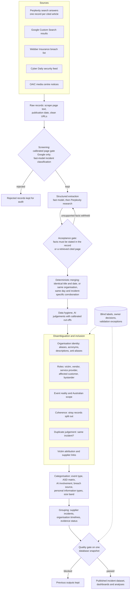

# Data collection methodology

This document describes how the dataset of Australian cyber incidents is collected, structured, disambiguated,
merged, categorised and validated. It is written as the methods section of a research paper, for readers who study
cyber risk rather than software. Module and command names appear only in Appendix A.

**Figures.** Unless stated otherwise, every count is taken from the published database snapshot
`snap-20261106160634-1edbf49c696a` (taken 6 November 2026 at 16:06 Australian Eastern Standard Time, last
record ingested 3 November 2026, published on 11 November 2026 after the quality gate passed). Calibration and
held-out figures come from the files committed in `evaluation/` and from the deployment report computed on them;
each calibration's date is given where it is used. Appendix B lists the queries behind the figures.

---

## 1. Unit of analysis and scope

The unit of analysis is the **incident**: one cyber attack, compromise or exposure affecting one organisation. The
dataset is built from **reports** (news articles, regulator notices, breach lists, search answers), and the central
methodological problem is turning many reports of uneven quality into one record per incident, with the right
organisation, the right date and nothing that is not an incident.

An incident is in scope when it affects Australia: the affected organisation is Australian (or the Australian arm of
a foreign organisation), or the reporting places people or organisations in Australia among those affected. A
foreign incident to which Australia only reacts, or one whose users merely "must include" Australians, is out of
scope. Incidents are collected from 1 January 2020. Earlier incidents enter the database only when later reporting
mentions them; they are kept, but excluded from the published reporting window and from the recurrence analysis,
because their coverage is incidental rather than searched for.

A breach at a supplier (software vendor or service provider) that exposes several customers is recorded as the
supplier's own incident plus one incident per affected customer, linked to each other as one supplier incident
(Section 6.3). This keeps each customer's exposure countable as an incident at that customer while still allowing
analysis by supplier.

In the snapshot, the database holds 1,269 active incidents, of which 1,168 are dated from 1 January 2020 to the
snapshot date, 95 are dated before 2020 and 6 are undated. A further 2,615 provisional events were merged into
others and 1,004 were rejected; both remain in the database for audit.

---

## 2. Pipeline overview

Figure 1 shows the stages. Each is described in the sections that follow.

*Figure 1. Stages from sources to the published incident dataset. Diamonds are decision points; the dotted lines
show where human and AI labels decide cases directly and test the result. For a LaTeX redraw: a top-to-bottom
flow with five source boxes merging into "raw records", then screening (with a rejection branch), extraction with a
feedback loop through the acceptance gate, deterministic merging, a grouped "disambiguation and inclusion" block of
six judgement steps fed by a label store, categorisation, grouping, and a final quality gate with "blocked" and
"passed" branches.*

---

## 3. Data sources

No register of Australian cyber incidents exists. The statutory Notifiable Data Breaches scheme publishes only
aggregate statistics, and media coverage is selective. The dataset therefore combines five sources with different
selection mechanisms (Table 1). Collection runs month by month; the collection months span January 2020 to November
2026 (83 months).

*Table 1. Sources. "Records" are stored raw reports of any status; "Active events" are active incidents with at least
one active report from the source (an incident can have several sources, so shares sum to more than 100%).*

| Source | What it covers | Records | Active events (share of 1,269) | Events from this source alone |
|---|---|---|---|---|
| Perplexity (sonar-pro search model) | Seven monthly queries by sector and incident type; each article an answer cites becomes its own record | 3,334 | 800 (63%) | 367 |
| Cyber Daily (Security section feed) | Trade outlet; strong on ransomware leak-site claims against small organisations; read back to January 2020 | 4,735 | 536 (42%) | 271 |
| Webber Insurance breach list | Curated chronological list of Australian breaches, by month of listing | 840 | 396 (31%) | 93 |
| Google Custom Search | Four monthly queries; results matched on title and snippet | 4,791 | 256 (20%) | 60 |
| OAIC media centre | Regulator announcements, determinations and investigations | 131 | 29 (2%) | 2 |

Nineteen further records come from reports cited by labels, from targeted replacement searches and from records of
unknown origin. Of the active incidents, 794 rest on reports from a single source, 274 on two and 201 on three or
more; the mean incident has 3.8 reports (median 1, maximum 127).

The Office of the Australian Information Commissioner's semi-annual statistics are collected separately (from its
PDF reports to 2024, its Power BI dashboard to June 2025 and data.gov.au from July 2025) and are used only as an
external benchmark for the published charts, never as incident records. GDELT was evaluated and dropped for cost
and poor fit.

**Known biases.** Every source is a filter on what was reported publicly:

* *Media selection.* Large, listed, government and consumer-facing organisations are reported more, and more
  often, than small private ones. Cyber Daily partly offsets this for ransomware claims, but its own selection
  (leak-site monitoring) favours ransomware over other incident types.
* *Search-engine dependence.* Perplexity and Google return what their indexes rank; neither is reproducible over
  time, and Perplexity's model is an alias, not a dated snapshot. All answers are stored (Section 9.6), so the
  dataset is reproducible from the database but the collection is not exactly repeatable.
* *Notification thresholds.* The OAIC scheme covers organisations with turnover above A$3 million (with
  exceptions) and breaches likely to cause serious harm; state agencies other than the ACT's are outside it.
* *Changing coverage.* Sources were added at different times (Cyber Daily in October 2026, read back to 2020), and
  source volumes vary by year. The published counts rise from 69 incidents dated 2020 to 282 dated 2026 to the
  snapshot; part of this rise reflects reporting and collection intensity, not incidence.
* *Reporting lag.* The first report of an incident follows the incident by a median of 12 days (mean 132 days, 871
  incidents where both dates are known). Incidents near the end of the window are under-collected.

---

## 4. Collection, screening and structured extraction

### 4.1 Collection and screening

For each source and month, the pipeline stores every report it finds, fetches the full page with a headless
browser, records the page's own publication date (from feed metadata, page metadata or the URL path, never from a
listing page that many incidents cite) and strips tracking and identity parameters from URLs. Failures are typed
(throttled, missing, network, parse, incomplete) and retried with back-off; a month with lost results is searched
again, so an outage does not leave a gap recorded as complete.

Two screens follow. First, for Google results only, a calibrated page gate asks whether the page itself reports an
incident and removes pages below its cut-off; Google's snippet matching picks up incident words from menus,
footers and privacy policies. The same gate scores other sources' pages but does not act on them, because the
labels showed it would remove real incidents there. Second, a fast language model classifies each kept report as a
specific cyber incident or not. Of 13,850 stored reports, 5,471 were rejected by these filters; they are kept for
audit.

### 4.2 Fields extracted

Each kept report passes through two extraction steps. The fast model (GPT-5.4 mini) extracts a title, description,
event type, severity, the organisations named and their roles, and whether the event is Australian and specific.
Perplexity then researches the incident with the report's own stored text in the prompt and returns, with a
confidence for each: the incident date (when it happened, not when it was reported), the formal name of the
affected organisation, its industry, the threat actor, the attack method, the number of records or people
affected, and the sources consulted.

### 4.3 Checking facts against cited sources

A cited URL is not treated as support. Every page Perplexity cites is retrieved and cached (5,556 pages in the
snapshot, 4,737 with usable text), and each fact is accepted only if the report's own stored text, or a retrieved
cited page that names an organisation the report names, states it: a date to the precision claimed and not merely
as the page's own publication date; a count with its unit, basis (stated, estimated, "at least") and scope
(Australian or global). Unsupported claims are withheld from the record and kept separately with the reason, and a
confident unsupported claim keeps the record in a retry queue. Dates after discovery, confidences outside [0, 1] and
counts below 1 are rejected outright. A weaker answer never overwrites a stronger stored fact. Cited pages are
checked again on a schedule; when one changes, the facts resting on it are re-judged against the new text.

Records-affected figures are checked against the victim: an Australian-only organisation cannot lose more records
than Australia's population, so a vendor's global total attached to an Australian customer is corrected, while a
genuinely global victim keeps its figure. 485 of the 1,269 incidents carry a records-affected figure.

A missing confidence is stored as unknown rather than filled with a default value, and readers treat it as unknown.

### 4.4 Dates as intervals with verified precision

An incident's date is treated as an interval. A month-only date is the whole month, not its first day. An event's
precision is set only from verified evidence: a date the source states for the incident, or a researched date that
the citation check supported. Dates from different sources that nest (a month and a day within it) are reconciled
to the narrower; dates that do not nest leave the event's precision unverified. A Webber list heading gives the
month Webber listed the item, which is an upper bound on the incident date, not the incident date. A researched
date more than seven days after the source's own report date is discarded as describing another incident of the
same organisation. An event with no incident date is dated by its first report, and marked as such.

In the snapshot, 457 incidents have a verified day, 164 a verified month and 648 (51.1%) no verified precision;
within the 2020 window the unverified share is 50.3% (587 of 1,168). The stored date's basis is Perplexity research
for 815 incidents, a publication date (which may lag the incident) for 301, a date stated in the record for 24 and
the project owner's label for 6; the remainder were set by a repair rule or are unknown.

---

## 5. Disambiguation

### 5.1 Organisation identity

Reports name organisations inconsistently ("CommBank", "Commonwealth Bank of Australia", "CBA"), and names that
look alike may be different organisations ("Optus" and "Optus Stadium"). Names are resolved in three layers:

* **Aliases.** Names that a person knows to be equivalent are listed directly (64 aliases recorded by the owner).
  Every other candidate pair, proposed by name structure (containment, initials, spelling variants) or by evidence
  (two reports of one incident naming different victims), is put to Perplexity with an incident each name appeared
  in and any researched profile of either organisation. The answer is one of same, parent and subsidiary, related,
  different or unsure, with citations. Only "same" joins two names (827 model-confirmed aliases); 196 further
  aliases come from rules. A verdict is stored with a hash of the evidence it was made on and is asked again only
  when that evidence has changed and the pair matters to a current decision; the owner's verdicts are never
  re-asked and outrank every model's.
* **Anti-aliases.** Every verdict that two names are different, related or parent and subsidiary is listed (1,803
  pairs) and keeps those names apart everywhere, including in victim counting.
* **Joining is lossless and reversible.** Each fold of two entities records every link it moved; a later contrary
  verdict undoes model-made folds automatically, while folds the owner reviewed are reversed only by the owner.

**Acronyms** are resolved in context, record by record. "AP" is Associated Press in one report and an Australian
firm in another; "AFP" is the Australian Federal Police or a news agency photo credit. A record is placed under an
organisation when its own text names exactly one candidate in full; otherwise a calibrated choice model reads the
text around the mention, and below 0.9 the reasoning model re-judges it; anything still uncertain stays unresolved
rather than misattributed (153 acronym aliases are held in this contextual form). An acronym that two different
organisations fold into is contextual by construction.

**Descriptions that are not names.** "Australian sugar producer", "an Australian university" and "Australian Super
Funds" describe organisations without naming one. Whether a name identifies one organisation is judged by a
calibrated model question on the name and the sentence it came from (Section 9), not by word lists or
capitalisation; 611 names are recorded as descriptions. A description is never a victim, never joined to a real
name, and an event recorded under one is re-filled with the organisation its evidence names.

### 5.2 Roles: victim, vendor, service provider

Each organisation linked to an incident is given a role for that incident, separately from what kind of entity it
is (organisation, government body, product, person, threat actor). The roles follow the owner's definitions:

* **Victim:** an organisation whose systems were accessed without authorisation, disrupted or encrypted, or whose
  data (collected by it or held on its systems) was taken, exposed or destroyed. When one organisation's data sat on
  another's systems, both are victims, each of its own report. The people whose data it was are not victims, nor is
  an organisation whose name was impersonated, nor a parent of the organisation that ran the system.
* **Vendor:** the maker or operator of a software product, platform or device when the attack came through it (a
  flaw in the product, or a breach of a hosted platform holding customers' data). The maker of an exploited product
  is a vendor unless its own systems were breached. A customer's stolen credentials used on an unflawed product
  make no vendor.
* **Service provider:** a firm providing services rather than software (law firm, call centre, records storage,
  consultancy) whose own systems were breached and held the client's data.
* **Affected customer:** a customer named among others in a report about a vendor, provider or several customers;
  in a report about one customer's own exposure, that customer is the victim.
* Other roles: regulator, threat actor, product and bystander. A vendor label must quote the sentence of the
  reporting that shows the vendor's own system was compromised, or it becomes a bystander.

Roles are classified by the strong model (GPT-5.5) from each entity's mentions in the reporting, and reclassified
whenever an incident's membership or the role prompt changes. In the snapshot, 1,100 of 1,269 incidents have a
victim (980 distinct victim entities); 169 have none, mostly because their evidence names no victim. A calibrated
victim-attribution check asks whether the recorded victim is really the affected organisation and demotes it when
it is not; a replacement victim proposed from the evidence is, at present, only flagged (Section 9.3).

---

## 6. Merging reports into incidents

### 6.1 Deterministic rules

Two reports are merged without a model only when it is certain: an identical, specific title on the same date; or
the same victim organisation (by identity, never by a shared word) on the same exact day with at least one piece
of incident-specific corroboration and no conflict. Corroboration is a shared article URL (not a page cited by more
than three incidents), record counts within 25% of each other, an attacker name contained in the other's, or an
attack method sharing a corpus-rare word. A first day of a month does not count as an exact day, because that is
how month-only dates used to be stored. Measured on a copy of the database of 29 October 2026, these rules confirmed 90.3% of the
13,647 record pairs an earlier same-day rule had merged; the rest are left to the calibrated judgement.

### 6.2 Calibrated duplicate judgement

Every pair of incidents with the same victim organisation, dated or not, is a candidate (for organisations with
more than 60 incidents, candidates are ranked and capped). The decision model is shown both incidents' evidence,
how each date was determined and its precision, the gap between their date intervals, and the organisation's
researched incident timeline (Section 7.2). The question states the base rate: separate incidents at one
organisation close together are rare, and thin evidence is not evidence of a different incident. Scores between
0.2 and 0.9 are re-judged by the reasoning model. Pairs at or above the calibrated cut-off of 0.80 are merged;
pairs below 0.15 are recorded as different and veto any chain of merges that would join them through a third
incident.

Reports of AI incidents defeat pairing by victim, because their victims are often missing or wrong. AI-involved
incidents within 365 days of each other are therefore also paired regardless of victim, with a question variant
shown the AI base rate, and merged at their own calibrated cut-off (0.18).

### 6.3 Separating what does not belong

The opposite errors are also checked. A **stray record** (a report about a different incident inside an event) is
identified when the organisation it names shares no name with the event's, and is split out when a calibrated
coherence question scores it below 0.12. **Two incidents at one organisation merged as one** are detected only on
evidence of a separate incident (a verified date more than 90 days from the event's, or a match to another
incident in the organisation's timeline), never on a date gap alone; this check is report-only at present.

### 6.4 Supplier incidents

When a supplier is breached, its own report and each customer's report are separate incidents (Section 1). A
calibrated question asks, for each candidate customer, whether it was affected by the supplier's incident, and a
second asks whether two events are the same supplier incident; accepted pairs are linked, not merged. Each
customer is counted once, through its own event: on a supplier's multi-customer report the customers that have
their own events become affected customers, and the report is the supplier's. The snapshot holds 115 supplier
incidents, 86 of them with linked customer events (530 links).

### 6.5 Reversibility

Every merge, split and rejection is recorded with who or what decided it, the certainty, the method, the reasoning
and a snapshot of the prior state, and can be reversed from stored state. A split leaves a "different" ruling
between the parted reports, so a later automated pass cannot rejoin them. A ruling lapses when its basis does (for
example, when both records later leave the same event).

---

## 7. Inclusion, categorisation and grouping

### 7.1 Inclusion: is it a real, Australian incident?

Two calibrated questions decide inclusion over all of an event's evidence (page text, research, a corroboration
search for low scorers, and the victim's timeline). **Event reality** asks whether the event is a real, specific
incident; roundups, guidance pages, profiles, campaigns naming no victim, physical-security incidents and non-cyber
fraud are not. **Event scope** asks whether it affected Australia under the definition in Section 1. Scores in the
uncertain middle are re-judged by the reasoning model. Event scope acts at its cut-off; event reality is held to
report-only by the deployment rule (Section 9.3), so only events labelled as non-incidents are rejected on that
ground.

### 7.2 Categorisation

*Table 2. Categories and how each is assigned.*

| Category | Method | Distribution in the snapshot (1,269 incidents) |
|---|---|---|
| Event type | Fast model at extraction, from 13 types | Data breach 589, ransomware 309, other 145, phishing 64, vulnerability exploit 38, financial fraud 36, state-sponsored 25, denial of service 18, malware 17, other types or unset 28 |
| ASD risk matrix | Strong model (GPT-5.5): severity category C1 (most severe) to C6, one of 15 stakeholder categories and one of 6 impact types, following the Australian Signals Directorate's matrix; "insufficient information" when the evidence cannot decide | C1 46, C2 86, C3 176, C4 162, C5 151, C6 34; insufficient information 614 (48%) |
| AI involvement | Decision model over each report's full page text; four categories plus no AI; calibrated cut-off on P(AI) of 0.69 | AI as attacker 10, organisation's own misuse of AI 4, vulnerability in the victim's AI 4, no AI 1,251 |
| Breach source | Decision model choice among OAIC's three sources or "cannot tell" | Malicious or criminal attack 1,127, system fault 52, human error 45, unknown 45 |
| Personal information types | Decision model, one yes/no question per OAIC information type (eight types), read at 0.5, uncalibrated | Recorded for all 1,269 |
| Organisation size | Perplexity researches each organisation (website, annual report, company registers) and the band follows the ABS business-size definitions: small under 20 employees or A$10m revenue, medium 20-199 or A$10-100m, large 200-4,999 or A$100m-1b, huge 5,000+ or over A$1b; rules settle non-organisations as unknown | Victim entities: small 122, medium 320, large 320, huge 174, unknown 38, not sized 6 |

An ASD classification is redone whenever its inputs change. The OAIC-aligned categories (breach source,
information types) allow comparison with the regulator's statistics; they are applied to every incident, including
those outside the OAIC scheme.

### 7.3 Grouping

**Supplier incidents** group a supplier's own event with its customers' events (Section 6.4).

**Organisation timelines.** For each organisation with several events, Perplexity is asked once for its full
incident history, dated, with sources. The timeline is stored, shown to the duplicate, reality and attribution
judgements as context, re-researched whenever a new report about the organisation arrives, and reconciled against
the database to find coverage gaps and suspect events. The snapshot holds timelines for 995 organisations (2,031
versions).

**Evidence status.** Each incident is marked *supported* (its own page text and validated research: 881),
*partial* (one of them: 291) or *unsupported* (neither: 97, with the uncertain fields listed). Unsupported incidents
are queued for retrieval of their own reporting; another page's text is never substituted.

---

## 8. Models and replicability

Four models are used. The three OpenAI and TypeSafe models are pinned to dated versions; Perplexity is not:

* **OpenAI GPT-5.5** (`gpt-5.5-2026-04-23`): role classification, ASD classification, cluster partitions in the duplicate review,
  and escalation of uncertain decision-model scores with reasoning enabled.
* **OpenAI GPT-5.4 mini** (`gpt-5.4-mini-2026-03-17`): discovery classification, field extraction, entity
  extraction and incident descriptions. Routine calls run at temperature 0 without reasoning.
* **TypeSafe Jev** (`jev-1.14.0`): a decision model that answers typed questions (a choice among options, a
  yes/no, a graded score) with a probability distribution rather than a single answer. It is used for every
  bounded judgement that is calibrated: page gate, event reality, scope, coherence, duplicates, victim attribution,
  supplier links, proper names, AI involvement, breach source and information types.
* **Perplexity** (`sonar-pro`, an undated alias): discovery, research of incident facts, aliases, organisation
  profiles, sizes and timelines.

Jev is not fully deterministic (the same question can return 0.99 and then 0.98). Every model answer is therefore
stored with the question exactly as sent, a hash of the input, the model version that answered and, for Jev, the
full distribution, and is reused unless the question, the input or the model changes. The snapshot holds 135,384
stored judgements (124,683 Jev, 9,955 GPT-5.5, 746 GPT-5.4 mini). The final decision for each subject (Jev score
or its escalation) is stored against a hash of the evidence it was made on, and is read only while that evidence is
unchanged; the evidence is frozen while it is judged, and an event whose evidence changed between judgement and
action is not acted on. Perplexity answers, searches and timelines are stored because a live search cannot be
replayed. A replication from the published database therefore reproduces every decision; a replication from
scratch reproduces them up to model sampling variation (measurable from the stored distributions) and changes in
the web.

Every publication is built from one consistent database snapshot, retained with its hash, and every analysis
records the snapshot it read, so any published figure can be regenerated from its exact input. Changes to events,
memberships, roles and sizes are also logged with the time they became known, so the inputs can be reconstructed
as they stood at an earlier date.

---

## 9. Validation

### 9.1 Blind labelling

Every automated step that deletes, merges, splits or re-attributes is calibrated on labelled examples drawn from
this database. Samples are stratified on the model's own stored score: the low band, where a cut-off can lie, is
labelled in full, and seeded random samples are drawn above it and weighted back to their bands. Labellers are
blind to the score being calibrated and record a written rationale, usually with sources found by web search.

The labellers were **Claude Opus 5.5 subagents with web search**, working from the stored evidence. Of the 2,036
labels in the thirteen calibration label sets, 1,964 were made this way, 67 by the project owner and 5 by
owner-delegated review; the owner also supplied 46 record-date corrections and 2 supplier-role rulings.
Conventions the labellers applied are recorded in the rationales and labelling guides and are worth a reader's
scrutiny: a dark-web sale claim naming no victim is "unsure"; campaigns naming no victim, physical-security incidents
and non-cyber fraud are not incidents; a global breach counts as Australian only when a source places Australians
among its victims (confirmed by the owner, 29 October 2026); one supplier breach reported about several customers
is one supplier incident; and for coherence, a record is "different" only when its own content shows a separate
incident.

Labels are ground truth: an item a label decides is never put to a model, an item labelled one way is never acted
on the other way, and the calibration uses only items the model scored. Labels describe the database as it was when
labelled, so recalibration re-scores each labelled case on a retained copy of the database from labelling time,
using the current evidence readers.

### 9.2 Calibrated cut-offs

For each step, the cut-off is the most permissive score at which at least 95% (weighted) of the labelled items it
would act on are correct. Each calibration records the models, question versions and an *evidence fingerprint* (a
hash of how the evidence shown to the model is assembled). If any of the three changes, the calibration no longer
applies and the step falls back to reporting until it is recalibrated.

### 9.3 The deployment rule

A cut-off chosen where labelled precision reaches 0.95 can rest on few labels: ten correct out of ten is also what
a true precision of 0.74 sometimes produces. A calibrated step therefore acts automatically only when its labelled
actions pass a deployment rule (policy version 2026-10-30.1):

1. the exact one-sided 95% Clopper-Pearson lower bound on the action's precision, from the unweighted labelled
   counts at the cut-off, is at least 0.80;
2. for a weighted calibration, the same bound computed from Kish's effective sample size of the acted-on items (with
   the weighted precision as the rate) also clears 0.80, so weighting cannot inflate the sample;
3. the labelled actions, and their effective number, are at least 15;
4. a held-out evaluation exists and its bound also clears 0.80. The labels are split into five folds by a hash of
   the subject; the cut-off is re-chosen on four folds with the step's own selection procedure and applied to the
   fifth, so every label is judged once by a cut-off it did not help choose.

At 0.80, an automatic action is shown with 95% confidence to be right at least four times in five; with every
labelled action correct this needs 14 actions, with one wrong 22. All automatic actions are logged and reversible.
A step that fails the rule is report-only: it acts only on labelled items. Bootstrap out-of-sample estimates are
also computed and reported, but are not used to gate.

*Table 3. Calibrated steps and the deployment rule, as committed. "Labelled cases" are those scored and used;
"Correct/acted" are labelled actions at the cut-off; bounds are one-sided 95% lower bounds (the lower of the
unweighted and effective-n bounds).*

| Step (calibrated) | Action | Labelled cases | Cut-off | Correct / acted | Lower bound | Held-out correct / acted | Held-out bound | Decision |
|---|---|---|---|---|---|---|---|---|
| Page gate (27 Oct) | remove a Google page | 132 | < 0.58 | 95/100 | 0.898 | 95/101 | 0.886 | acts |
| Event reality (30 Oct) | reject event | 170 | < 0.22 | 69/72 | 0.896 | 46/51 | 0.682 | report-only |
| Event scope (30 Oct) | reject as not Australian | 144 | < 0.68 | 64/67 | 0.888 | 62/66 | 0.867 | acts |
| Coherence (29 Oct) | split stray record | 92 | < 0.12 | 17/17 | 0.838 | 16/16 | 0.829 | acts |
| Same-organisation coherence (30 Oct) | split separate incident | 94 | < 0.06 | 25/26 | 0.830 | 28/31 | 0.768 | report-only |
| Duplicates (31 Oct) | merge | 155 | >= 0.80 | 16/16 | 0.829 | 15/15 | 0.819 | acts |
| AI-incident duplicates (2 Nov) | merge | 113 | >= 0.18 | 68/75 (n_eff 62.6) | 0.832 | 68/73 | 0.861 | acts |
| Victim attribution (30 Oct) | demote recorded victim | 152 | < 0.12 | 44/46 | 0.869 | 42/44 | 0.864 | acts |
| Victim attribution | replace victim | (same) | >= 0.82 | 21/22 (n_eff 10.6) | 0.708 | 20/22 | 0.666 | report-only |
| Victim fill (30 Oct) | give a victim to an event with none | 92 | none reaches the target | - | - | - | - | off |
| Supplier customers (30 Oct) | link a customer | 102 | >= 0.85 | 52/54 | 0.888 | 53/56 | 0.854 | acts |
| Supplier same-incident | link two events | 97 | >= 0.87 | 33/34 | 0.868 | 34/37 | 0.804 | acts |
| Supplier different | keep two events apart | (same) | < 0.09 | 44/44 (n_eff 38.5) | 0.925 | 46/49 | 0.849 | acts |
| AI involvement (29 Oct) | flag as AI-involved | 122 | P(AI) >= 0.69 | 34/35 | 0.871 | 33/35 | 0.831 | acts |
| Proper names (29 Oct) | treat as a description | 182 | < 0.20 | 57/60 | 0.876 | 59/62 | 0.880 | acts |

The duplicate "different" veto (123 of 123 correct below 0.15) only prevents merges and is not gated. Three
actions are held back: event-reality rejection would need about 24 more labelled rejections, all correct;
same-organisation splits about 6; victim replacement about 9. Recall at the cut-offs is moderate by design (for
example 0.63 weighted for event reality and 0.39 for victim attribution): the cut-offs trade recall for precision,
and what they leave is reported for review.

### 9.4 Owner decisions and validation exceptions

The project owner reviews published outputs and records corrections as labels that decide cases directly: for
example, that a regulator's definitions of victim and vendor apply, that the July 2024 CrowdStrike outage is not a
cyber incident, or that two close-together events at one organisation are one incident. No data is corrected by
hand: each correction becomes a reproducible rule or label.

Every wrong result the owner reports is also stored as a **validation exception** (a test, never an input),
anchored on the reports involved so it survives merges: that an organisation is or is not a victim of an event,
that two events are or are not the same incident, the incident's month, supplier customers and vendors. The
snapshot holds 130 exceptions; at its quality run 124 passed, none failed and 6 could not be checked. A further 30
acceptance cases from an earlier review are checked each run (3 same-incident cases not yet satisfied).

### 9.5 The quality gate

Each publication measures the snapshot it will publish against committed thresholds. Blocking checks are: data
integrity (including that every published chart total reconciles with the incident population), contradictions of
labelled outcomes (no more than 2), fixed synthetic cases for the deterministic rules, future or malformed dates,
stale ASD classifications (no more than 5%), and a readable deployment policy. A check that cannot run counts as
failed. The quality run for this snapshot (11 November 2026) passed with no blocking failure and 16 warnings,
among them: the three report-only actions; 29 pairs of incidents at one organisation dated within 90 days of each
other (threshold 10, the band where reporting-lag duplicates concentrate); 7.6% of incidents with unsupported
evidence (threshold 2%); and 106 enrichments that failed three attempts and await review.

### 9.6 Where AI judgements are used, and how they are checked

AI models decide or inform every step after collection: classification and extraction (not calibrated, but facts
are checked against retrieved sources), role assignment (checked by the calibrated attribution step and by owner
exceptions), ASD classification (not calibrated; abstains rather than defaulting), and the calibrated decision
questions of Table 3. For the calibrated questions, Jev answers first, uncertain scores are escalated to the
reasoning model, whose probability replaces Jev's, and the combined score is what is calibrated; the deployment
rule then decides whether the score may act. Aliases and co-victim identity rest on Perplexity verdicts that are not
calibrated on labels; they never change an event's membership on their own.

---

## 10. Limitations and threats to validity

1. **Reported incidents, not incidents.** The dataset is a census of public reporting. Small private organisations,
   incidents never disclosed and incidents below notification thresholds are under-represented, and growth over
   time partly reflects reporting and collection intensity. Rates should be read as rates of *reported* incidents.
2. **Period.** Collection starts in January 2020. Pre-2020 incidents present in the database are incidental and are
   excluded from the reporting window and the recurrence analysis; an organisation's earlier history is unobserved.
3. **Date precision.** About half of incident dates (51.1% overall, 50.3% within the window) have no verified
   precision, and 301 are publication dates that may lag the incident. Analyses of timing must treat dates as
   intervals and test sensitivity to date assumptions.
4. **AI labellers.** The ground truth for calibration was produced by AI subagents with web search, not by
   independent human coders, and inter-rater agreement was not measured. The owner's review has corrected individual
   labels, and the labelling conventions are explicit, but systematic agreement between labeller and labelled model
   (both large language models) could inflate measured precision.
5. **Calibration sample sizes.** Several actions rest on 16-35 labelled actions; their lower bounds lie between 0.83
   and 0.87, and held-out counts are small. Three actions are report-only for this reason, and recall at the cut-offs
   is moderate, so residual duplicates, strays and misattributed victims remain (the gate's 29 short-gap pairs are
   an example).
6. **Calibration drift.** Labels describe the database at labelling time; recalibration re-scores them with current
   evidence readers on retained snapshots, which certifies the reader rather than today's data.
7. **Uncalibrated judgements.** Event type, severity, ASD category, personal information types, organisation size,
   alias verdicts and role classification are not calibrated on labels; they are checked by consistency rules, owner
   exceptions and, for facts, citation support.
8. **Search-model reproducibility.** Perplexity is not pinned to a dated model and the web changes; stored answers
   make the dataset reproducible, but a re-collection would differ.
9. **Missing victims and evidence.** 169 incidents have no victim role and 97 have unsupported evidence; they are
   counted as incidents but contribute nothing to per-organisation analyses.

---

## Glossary

| Term | Meaning |
|---|---|
| Report (record) | One stored article, notice, list entry or search answer about a possible incident |
| Incident (event) | One cyber attack, compromise or exposure affecting one organisation, made from one or more reports |
| Supplier incident | A supplier's breach together with the linked incidents of the customers it exposed |
| Victim | The organisation whose systems were accessed or disrupted, or whose data was exposed |
| Vendor / service provider | The software maker or service firm through whose compromise a customer was affected |
| Alias / anti-alias | A verified statement that two names are, or are not, the same organisation |
| Decision model (Jev) | A model that answers a typed question with a probability distribution |
| Escalation | Re-judging an uncertain decision-model score with a reasoning model over the same evidence |
| Calibration | Choosing a cut-off on a model's score from blind labels, at 95% labelled precision |
| Deployment rule | The test a calibrated cut-off must pass before it may act automatically (Section 9.3) |
| Report-only | A step whose judgements are recorded but not acted on, except for labelled items |
| Held-out evaluation | Precision measured on labels not used to choose the cut-off, by five-fold cross-validation |
| Evidence fingerprint | A hash of how the evidence shown to a model is assembled; a calibration applies only while it matches |
| Validation exception | A wrong result reported by the owner, kept as a regression test |
| Snapshot | A retained, hashed copy of the database from which a publication or analysis was built |
| Verified precision | The day or month of an incident date, set only from a source-stated or citation-supported date |

---

## Appendix A. Steps, modules and commands

Paths are relative to the repository root. Commands are run from the root; `dedup_admin.py` is
`scripts/dedup_admin.py`.

| Step | Module(s) | Command |
|---|---|---|
| Collection by source and month | `cyber_data_collector/datasources/` (`perplexity.py`, `google_search.py`, `webber_insurance.py`, `cyberdaily.py`, `oaic.py`), `pipelines/discovery.py` | `python run_full_pipeline.py --discover-only`; `scripts/discovery_queue.py` |
| Page scraping, publication dates, URL cleaning | `utils/entity_scraper.py`, `processing/publication_dates.py`, `utils/url_clean.py` | `dedup_admin.py publication-dates` |
| Page gate (screening) | `filtering/page_gate.py`, `dedup/source_gate.py` | `dedup_admin.py check-sources` |
| Extraction and Perplexity research | `utils/llm_extractor.py`, `processing/perplexity_enricher.py`, `processing/record_evidence.py` | `scripts/perplexity_backfill_events.py` |
| Acceptance gate, citation support | `processing/enrichment_gate.py` | `scripts/perplexity_backfill_events.py --recompute-reliability` |
| Cited pages checked again | `processing/cited_documents.py`, `processing/cited_refresh.py` | `dedup_admin.py refresh-cited-documents` |
| Incident dates and precision | `processing/incident_dates.py`, `dedup/date_provenance.py` | `dedup_admin.py publication-dates`, `redate` |
| Record identity repair | `processing/record_identity.py` | `dedup_admin.py check-record-identity` |
| Aliases, acronyms, anti-aliases, entity folds | `dedup/entity_alias_verification.py`, `dedup/alias_learning.py`, `dedup/contextual_aliases.py`, `dedup/anti_aliases.py`, `dedup/entity_merge_ledger.py` | `dedup_admin.py canonicalise-entities`, `anti-alias`, `alias add`, `unmerge-entity` |
| Proper names / descriptions | `dedup/name_judgement.py`, `dedup/descriptive_names.py` | `dedup_admin.py judge-names`, `descriptive-name` |
| Roles | `dedup/entity_classification.py`, `dedup/role_maintenance.py` | `dedup_admin.py classify-entities`, `roles-status` |
| Victim attribution and fill | `dedup/victim_judgement.py`, `dedup/victim_fill.py` | `dedup_admin.py check-victim-attribution`, `fill-victims` |
| Deterministic merging | `processing/deduplication_v2.py`, `dedup/merge_corroboration.py` | `scripts/run_global_deduplication.py` |
| Duplicate judgement (organisation and AI routes) | `dedup/duplicate_judgement.py`, `dedup/bounded_candidates.py` | `dedup_admin.py check-duplicates` |
| Coherence (strays, same organisation) | `dedup/coherence.py`, `dedup/coherence_same_org.py` | `dedup_admin.py check-coherence`, `check-same-organisation` |
| Event reality and scope | `dedup/event_reality.py`, `dedup/event_scope.py` | `dedup_admin.py check-events`, `check-scope` |
| Supplier incidents | `dedup/supplier_victims.py`, `dedup/supplier_links.py`, `dedup/multi_customer_incidents.py` | `dedup_admin.py find-supplier-victims`, `supplier-incidents` |
| Organisation timelines | `dedup/org_timeline.py`, `dedup/timeline_reconciliation.py` | `dedup_admin.py research-timelines`, `reconcile-timelines` |
| Evidence status and recovery | `processing/evidence_recovery.py` | `dedup_admin.py recover-evidence` |
| Escalation to the reasoning model | `utils/escalation.py` | (within each judging step) |
| Stored judgements, final decisions | `utils/jev.py`, `dedup/final_decisions.py` | - |
| ASD classification | `scripts/asd_risk_classifier.py` | `python scripts/asd_risk_classifier.py` |
| AI involvement | `scripts/classify_ai_involvement.py` | same |
| Breach source and information types | `scripts/enrich_pii_and_source_category.py` | same |
| Organisation size | `dedup/entity_size.py` | `dedup_admin.py size-entities` |
| Calibration | `scripts/calibrate_*.py`, `dedup/calibration_guard.py` | `dedup_admin.py recalibrate` |
| Deployment rule and held-out evaluation | `dedup/deployment.py`, `evaluation/deployment_policy.json` | `python scripts/evaluate_calibrations.py report` / `evaluate` |
| Validation exceptions | `dedup/validation_exceptions.py` | `dedup_admin.py validation-exception check` |
| Quality gate | `cyber_data_collector/quality/`, `cyber_data_collector/quality/thresholds.json` | `python scripts/quality_report.py` |
| Snapshot and publication | `cyber_data_collector/publication/` | `python scripts/publish_outputs.py` |
| Inputs as known at a date | `dedup/input_history.py` | `dedup_admin.py input-history`; analyses' `--as-known-at` |

Further detail: [01-data-sources.md](01-data-sources.md), [05-event-enrichment.md](05-event-enrichment.md),
[09-deduplication-v3.md](09-deduplication-v3.md), [10-victim-attribution-and-timelines.md](10-victim-attribution-and-timelines.md),
[10-supplier-incidents.md](10-supplier-incidents.md), [10-quality-gate.md](10-quality-gate.md),
[11-evidence-recovery.md](11-evidence-recovery.md) and [data-dictionary.md](data-dictionary.md).

## Appendix B. Provenance of the figures

* Snapshot `snap-20261106160634-1edbf49c696a`, SHA-256 `1edbf49c696a2e3d...8afa8676`, retained in
  `instance/snapshots/` and named in `dashboard/publication.json`; quality run `qr-20261111211610-6bb96b`.
* Incident counts: active rows of the deduplicated events table; window counts use event dates from 1 January 2020
  to the snapshot date. Source shares count active incidents with at least one active member report of the source.
* Date precision, date basis, evidence status, categories and roles: columns of the active incidents and their
  entity links in the snapshot; size bands are those of distinct victim entities.
* Labelled counts: rows of `evaluation/*_labels.csv` by labeller; calibration figures: `evaluation/*_calibration.json`
  (generation dates as given in Table 3); held-out figures and decisions: `evaluation/*_heldout.json` via
  `python scripts/evaluate_calibrations.py report`.
* Quality gate warnings and validation-exception results: the quality run's stored metrics.
* The deterministic-rule corroboration figures (Section 6.1) are from the 29 October 2026 measurement reported in
  the README, not from this snapshot.
